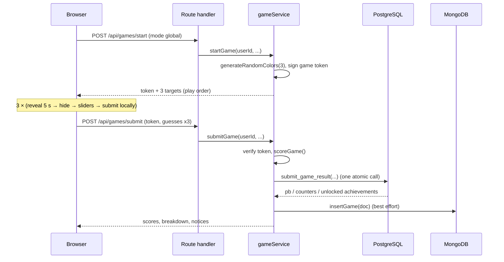
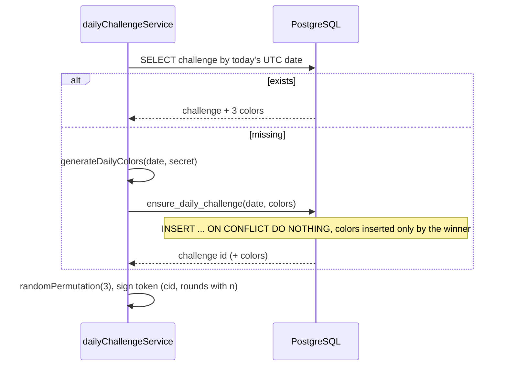
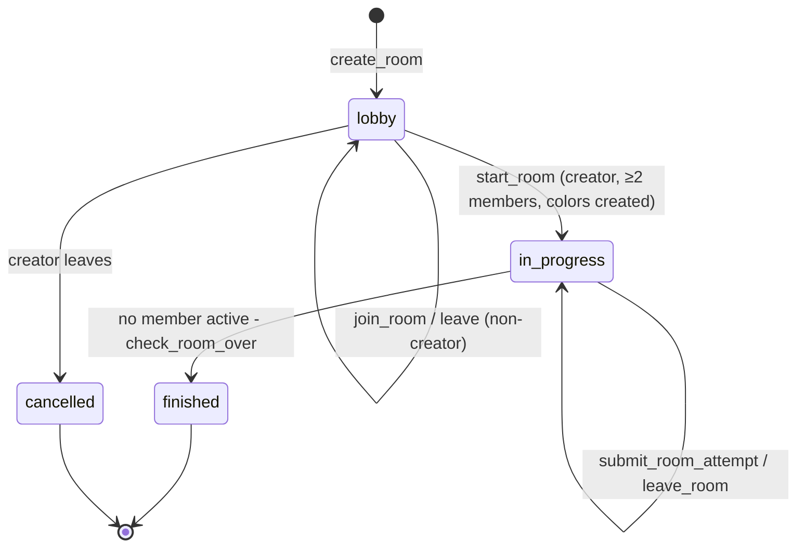
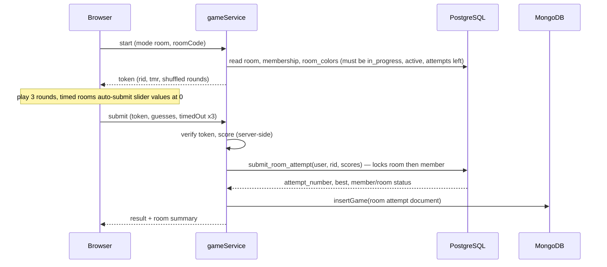

# ChromaMatch — Application Architecture (High-Level and Mid-Level)

> This document specifies **how ChromaMatch is built**: the technology stack, the high-level system architecture, and the mid-level design of every module, flow and interface.
> It is the bridge between the two design documents and the code:
> - `ChromaMatch_Game_Design.md` — **what** the game is (rules, modes, roles).
> - `ChromaMatch_Database_Design.md` — **the data layer** (ER diagram, relational schema, MongoDB model, integrity rules).
> - **This document** — **how the application is structured** (layers, modules, contracts, flows, conventions).
>
> Status: **tentative**, like the other two documents. Where the design documents leave an item undecided, Section 6 records the **default adopted for implementation** so that nothing blocks development. Each default can be changed later in one place.
>
> Reading guide for humans and coding tools: Sections 1–4 give the big picture. Section 5 is the detailed specification and is the one to follow while writing code. Section 6 lists adopted defaults. Section 7 maps course requirements to design elements. Section 8 holds catalogs (error codes, constants, proposed achievements).

---

## Table of contents

1. [Purpose, scope and conventions](#1-purpose-scope-and-conventions)
2. [Architectural drivers](#2-architectural-drivers)
3. [Technology stack](#3-technology-stack)
4. [High-level architecture](#4-high-level-architecture)
5. [Mid-level architecture](#5-mid-level-architecture)
   - 5.1 [Repository structure](#51-repository-structure)
   - 5.2 [Layering and dependency rules](#52-layering-and-dependency-rules)
   - 5.3 [Shared constants and configuration](#53-shared-constants-and-configuration)
   - 5.4 [Domain modules (pure logic)](#54-domain-modules-pure-logic)
   - 5.5 [Authentication and sessions](#55-authentication-and-sessions)
   - 5.6 [Game tokens](#56-game-tokens)
   - 5.7 [Service layer](#57-service-layer)
   - 5.8 [PostgreSQL layer](#58-postgresql-layer)
   - 5.9 [MongoDB layer](#59-mongodb-layer)
   - 5.10 [HTTP API contract](#510-http-api-contract)
   - 5.11 [Frontend architecture](#511-frontend-architecture)
   - 5.12 [Sequence diagrams and state machines](#512-sequence-diagrams-and-state-machines)
   - 5.13 [Cross-cutting concerns](#513-cross-cutting-concerns)
   - 5.14 [Testing strategy](#514-testing-strategy)
   - 5.15 [Development environment, CI and deployment](#515-development-environment-ci-and-deployment)
6. [Defaults adopted for open items](#6-defaults-adopted-for-open-items)
7. [Traceability to course requirements](#7-traceability-to-course-requirements)
8. [Appendices](#8-appendices)

---

## 1. Purpose, scope and conventions

### 1.1 Purpose
Give a developer (or an AI coding tool such as opencode) everything needed to implement ChromaMatch without guessing: module boundaries, responsibilities, data flows, API shapes, algorithms, error handling, concurrency rules and operational setup.

### 1.2 In scope
- All three game modes: **Global**, **Daily**, **Custom Room**.
- Accounts, roles (player/admin), bans, statistics, streaks, achievements, leaderboards, admin tooling.
- Both databases (PostgreSQL and MongoDB) and how the application talks to them.

### 1.3 Out of scope
- Column-level DDL and the ER diagram (see the database document; this document only adds *behavioural* specifications such as procedure signatures, and a small number of explicitly flagged refinements).
- Visual design (colors, typography, layout details) beyond functional UI requirements.
- Real-time infrastructure (WebSockets). Rooms use polling.

### 1.4 Conventions used in this document
- **MUST / MUST NOT / SHOULD / MAY** are used in their RFC 2119 sense. A coding tool should treat MUST/MUST NOT as hard constraints.
- Names in `monospace` are identifiers (tables, columns, functions, files, endpoints, env vars).
- Table and column names refer to the database document (`users`, `room_players`, ...).
- "Server" means Next.js route handlers and the service layer. "Client" means code running in the browser.
- "Play order" means the order in which a given player sees the 3 colors of a game (may be shuffled). "Color number" (1–3) is the identity of a shared color (`challenge_colors.round_number` / `room_colors.round_number`).
- All times are **UTC**. A "day" is a UTC calendar date.
- HSV ranges: **H 0–360, S 0–100, V 0–100**, one decimal place.
- Scores: round 0.0–10.0, game/attempt 0.0–30.0, one decimal place.

### 1.5 Corrections and refinements this document makes to earlier documents
These are small and deliberate; they are repeated where relevant.

| # | Where | Refinement |
|---|---|---|
| R1 | Database doc §7.2 example | The example round score `8.9` for target (214.6, 62.0, 80.5) vs guess (209.0, 58.5, 77.0) is **illustrative only**. With the scoring formula and equal weights the correct score is **9.7**. Do not use the example numbers as test data; use the test vectors in §5.4.1. |
| R2 | Database doc §6.1 | Optional: make username uniqueness **case-insensitive** (unique index on `lower(username)`) so `Alice` and `alice` cannot both exist. The existing `UNIQUE(username)` can stay as well. |
| R3 | Database doc §8.4 | Use `ROW_NUMBER()` (not `RANK()`) with a deterministic tie-break (earliest achieved time, then lowest `user_id`). This satisfies "ties are ranked arbitrarily" and makes pagination stable. |
| R4 | Game doc §2 step 5 vs §3 | Because the whole game is scored by the server in **one request after round 3**, round scores and per-channel breakdowns are shown **together on the game result screen**, not after each individual round (this matches the screen-flow diagram in the game document). |

---

## 2. Architectural drivers

### 2.1 Functional drivers
- Three modes with different color sources (random / date-seeded shared / room-shared) but identical round and scoring mechanics.
- Whole games are submitted at once; incomplete games leave no trace.
- Personal-best logic (strictly greater replaces), daily streaks, achievements, leaderboards computed on demand.
- Private asynchronous rooms with lobby, capacity, forfeiting, automatic end.
- Admin moderation (view, edit stats, ban/unban).

### 2.2 Quality drivers (in priority order)
1. **Correctness and integrity of scores/PBs/room results.** Leaderboard-feeding data is authoritative in PostgreSQL and changes only through transactional functions.
2. **Server-authoritative scoring.** The browser MUST NOT be able to submit a score or choose the target colors it is scored against.
3. **Simplicity.** Two-person student team; free-tier infrastructure; a monolithic Next.js app is enough.
4. **Satisfying the course rubric:** two database paradigms, SQL features (transactions, procedures/functions, triggers, views, indexes), NoSQL aggregation, validation at the DB level, security basics.
5. **Graceful degradation.** If MongoDB is unavailable, play and leaderboards still work.
6. **Testability.** Pure logic is separated from I/O so it can be unit-tested.

### 2.3 Constraints
- Browser game; Next.js frontend and backend (design decision).
- PostgreSQL + MongoDB (design decision). No vector database.
- Authentication is self-managed (email + password hash) in Postgres; no third-party auth providers.
- All secrets in environment variables.
- Free-tier hosting (Supabase Postgres, MongoDB Atlas M0, Vercel Hobby or equivalent).

---

## 3. Technology stack

| Layer | Technology | Notes |
|---|---|---|
| Language | **TypeScript** (`strict: true`) everywhere | Shared types between client and server. |
| Runtime | **Node.js LTS** (20 or 22) | Route handlers MUST run on the **Node.js runtime** (not Edge) because the app uses native/TCP database drivers and argon2. |
| Framework | **Next.js (App Router)** | Pages + Route Handlers (`app/api/**/route.ts`) in one repository. |
| UI | **React**, **Tailwind CSS** | Custom HSV sliders and color swatches; a component kit (shadcn/ui) is optional. |
| Client data layer | **TanStack Query** | Fetching, caching and polling (lobby, room scoreboard, leaderboards). |
| Validation | **Zod** | Request/response schemas; shared by client and server. |
| PostgreSQL host | **Supabase (as plain Postgres)** | Supabase Auth/Realtime/Storage are NOT used. |
| Postgres driver / ORM | **postgres.js** + **Drizzle ORM** + **drizzle-kit** | Drizzle for typed table access and generated migrations; raw SQL (`sql` template) for functions, procedures, views, triggers, partial indexes. |
| MongoDB host | **MongoDB Atlas (M0 free tier)** | |
| Mongo driver | **Official `mongodb` Node driver** | No Mongoose: the JSON Schema validator and aggregation pipelines are used directly. |
| Password hashing | **argon2id** (`@node-rs/argon2`) | bcrypt is an acceptable fallback; passwords are never stored or logged in plain text. |
| Sessions | **Signed JWT in an httpOnly cookie** via **`jose`** | Stateless; no sessions table. |
| Game tokens | **Signed JWT (separate secret)** via **`jose`** | See §5.6. |
| Charts | **Recharts** | Profile statistics. |
| Testing | **Vitest** (unit + integration), **Playwright** (optional end-to-end) | |
| Lint/format | ESLint, Prettier, `tsc --noEmit` | Run in CI. |
| Version control / CI | Git + GitHub, GitHub Actions | |
| Hosting | **Vercel** (app), **Supabase** (Postgres), **MongoDB Atlas** (Mongo) | |
| Local development | **Docker Compose** with `postgres` and `mongo` containers | See §5.15. |

Version policy: use the latest stable releases at scaffolding time and **pin exact versions** via the lockfile. Do not add libraries not listed here without a written reason.

---

## 4. High-level architecture

### 4.1 System context

```
                     ┌──────────────────────┐
   Player / Admin ──►│  Web browser (SPA-ish │
                     │  Next.js client)      │
                     └──────────┬───────────┘
                                │ HTTPS (JSON, cookie session)
                     ┌──────────▼───────────┐
                     │  ChromaMatch server  │
                     │  (Next.js on Vercel) │
                     └───────┬────────┬─────┘
                             │        │
                  SQL over   │        │  MongoDB wire protocol (TLS)
                  TLS        │        │
                  ┌──────────▼──┐  ┌──▼────────────┐
                  │ PostgreSQL  │  │ MongoDB Atlas │
                  │ (Supabase)  │  │ game_history  │
                  └─────────────┘  └───────────────┘
```

There are no other external systems: no email service, no OAuth provider, no queue, no cache server, no WebSocket server.

### 4.2 Container view

```
┌──────────────────────────────── Browser ─────────────────────────────────┐
│  Next.js pages (React client components)                                 │
│   • Auth screens         • Mode select / home                            │
│   • Game screen (state machine: reveal → hide → guess → submit)          │
│   • Result screen        • Leaderboards                                  │
│   • Room lobby / play / scoreboard (polling)                             │
│   • Profile (stats, streak, achievements)  • Admin panel                 │
│  TanStack Query cache · Zod schemas · HSV→CSS color util                 │
└───────────────────────────────────┬──────────────────────────────────────┘
                                    │ fetch('/api/...') — JSON
┌───────────────────────────────────▼──────────────────────────────────────┐
│                       Next.js server (Node runtime)                      │
│                                                                          │
│  Route handlers (thin) ──► parse/validate (Zod) ──► auth/guards          │
│            │                                                             │
│            ▼                                                             │
│  Service layer: authService · gameService · dailyChallengeService ·      │
│                 roomService · leaderboardService · statsService ·        │
│                 adminService                                             │
│            │                         │                                   │
│            ▼                         ▼                                   │
│  Domain modules (pure):        Data access:                              │
│   scoring · colors · shuffle    pg/ (Drizzle + raw SQL calls)            │
│   time · gameToken · hsv        mongo/ (history repo + aggregations)     │
└──────────────┬──────────────────────────────┬────────────────────────────┘
               │                              │
   ┌───────────▼───────────┐       ┌──────────▼─────────┐
   │ PostgreSQL            │       │ MongoDB            │
   │ tables · constraints  │       │ game_history       │
   │ functions/procedures  │       │ JSON Schema        │
   │ triggers · views      │       │ indexes            │
   │ indexes               │       │ (insert-only)      │
   └───────────────────────┘       └────────────────────┘
```

### 4.3 Deployment view

| Component | Where it runs | Connection |
|---|---|---|
| Next.js app (pages + route handlers) | Vercel (serverless functions, Node runtime). Choose the function region closest to the Supabase region. | — |
| PostgreSQL | Supabase project (managed Postgres) | App uses the **pooler** connection string (`DATABASE_URL`); migrations and seeds use the **direct/session** connection string (`DATABASE_URL_DIRECT`). |
| MongoDB | Atlas M0 cluster; IP access list set to allow Vercel (Atlas "allow from anywhere" is acceptable for a course project if credentials are strong) | `MONGODB_URI` |
| Secrets | Vercel environment variables (production/preview), `.env.local` (developer machines) | Never committed. |

Free-tier caveats to be aware of (verify current limits): Supabase free projects can be **paused after a period of inactivity**; Atlas M0 has a small storage cap. Neither affects the design, but wake the project before demos.

### 4.4 Architectural principles

1. **Browser never talks to a database.** All access goes through route handlers.
2. **Server-authoritative scoring.** Scores are computed on the server against targets the server itself issued (via signed game tokens, §5.6). The client sends only **guesses**.
3. **Postgres is the system of record; MongoDB is the history log.** Postgres is written first, inside one transaction (one function call). MongoDB is written second, best-effort.
4. **Rules that span rows/tables live in the database** (functions, procedures, triggers, constraints). Rules that need computation or randomness live in TypeScript domain modules.
5. **Derived data is never stored.** Ranks, RGB/hex, leaderboards are computed on request.
6. **Thin route handlers, fat services, pure domain.** Business logic is not in route handlers, React components or SQL string literals scattered around the code.
7. **One way to do things.** All data reaches the UI through the HTTP API and TanStack Query (no mixing of server-component data fetching with API calls for the same data).
8. **Fail closed.** Any missing/invalid session, token, role or membership results in a rejection, never a silent default.
9. **Incomplete games are never persisted.** The client holds in-progress guesses in memory; the server only learns about a game when it is complete.

### 4.5 Data ownership matrix

| Data | Authoritative store | Notes |
|---|---|---|
| Accounts, roles, bans, password hashes | Postgres `users` | |
| Global PB, counters, streaks, last daily date | Postgres `users` | Changed only by `submit_game_result` and admin procedures. |
| Daily challenges and their 3 colors | Postgres `daily_challenges`, `challenge_colors` | Created lazily; immutable after creation. |
| Daily PBs | Postgres `daily_personal_bests` | |
| Achievements (definitions) / earned | Postgres `achievements` / `user_achievements` | Definitions seeded by developers. |
| Rooms, room colors, members, room best scores | Postgres `rooms`, `room_colors`, `room_players` | Changed only by room functions. |
| Leaderboards, scoreboards, ranks | **Not stored** — Postgres views | |
| Every completed game / room attempt (round by round) | MongoDB `game_history` | Insert-only; never read for leaderboards, PBs or achievements. |
| Session | Browser cookie (signed JWT) | No server-side session store. |
| In-progress game targets | **Game token** held by the browser | Signed, not stored server-side (§5.6). |
| In-progress guesses | Browser memory only | Lost if the tab closes (by design). |

### 4.5.1 Cross-database links
`game_history.user_id`, `.daily_challenge_id`, `.room_id` are logical references to Postgres rows; they are enforced by application code only. A transaction cannot span both databases (Database doc §8.3). Admin stat edits change Postgres only.

### 4.6 Trust boundaries

| Boundary | Trusted side | Untrusted side | Controls |
|---|---|---|---|
| Browser ↔ Server | Server | Everything from the browser (body, headers, cookies, tokens) | Zod validation, JWT signature checks, role/membership checks, server-side scoring, Origin check for mutating requests. |
| Server ↔ Databases | Server and DBs | — | Credentials in env vars; parameterized queries only; DB constraints as a second line of defense. |
| Game token | Server-signed | Browser-held | HMAC signature + expiry + user binding. The browser can read but not alter it. |

Known inherent limitation: targets must be sent to the browser to be displayed, so a determined cheater can read them from the network tab. The design limits what they gain (they cannot change what they are scored against or claim a score), but cannot prevent perfect guesses. Accepted for this project.

### 4.7 Request lifecycle (all API calls)

```
Request
  → (middleware: for page routes only — verify session cookie signature, redirect to /login if absent/invalid)
  → route handler
      1. Origin/CSRF check (mutating methods)
      2. Parse JSON body / query with Zod → 400 on failure
      3. Resolve session (verify JWT) → 401 if required and missing
      4. Role / membership guard → 403
      5. Call exactly one service function
      6. Map result → JSON response; map domain errors → HTTP status + error body
  → response (Cache-Control: no-store)
```

### 4.8 Key flows at a glance

| Flow | Summary |
|---|---|
| Register / login | Validate → hash/verify (argon2) → set session cookie. |
| Start a game (any mode) | Server builds the targets (random / today's challenge / room colors), shuffles play order, signs a **game token**, returns the colors to display plus the token. |
| Submit a game (any mode) | Verify token → score server-side → call Postgres function (PB / counters / streak / achievements / room best) → insert MongoDB history → respond with scores and notices. |
| Leaderboards | Read from Postgres views (banned users excluded for Global/Daily). |
| Room lifecycle | Create → join (lobby only) → creator starts (colors generated) → members play attempts independently → members finish/leave → room finishes automatically. |
| Stats | Postgres counters + MongoDB aggregations (Global/Daily only). |
| Admin | Guarded routes; stat edits and ban/unban via Postgres procedures. |

### 4.9 Failure modes and handling

| Failure | Effect | Handling |
|---|---|---|
| Postgres unavailable | Game cannot start/submit; leaderboards fail | Return 503 with `SERVICE_UNAVAILABLE`; client shows retry. No partial writes (transactions). |
| MongoDB unavailable at submit | History not recorded | Log error with context (user, mode, token `jti`); retry insert once; still return success to the player. |
| MongoDB unavailable at stats read | Aggregation stats missing | `/api/me/stats` returns Postgres counters and `history: null`, `historyAvailable: false`. |
| Game token invalid/expired/tampered | Submission rejected | 400 `TOKEN_INVALID` / `TOKEN_EXPIRED`; the game is lost (client may start a new one). |
| Same token submitted twice | Second submission would be counted again | Accepted limitation for Global/Daily (PB unaffected; only `total_games_played` inflates). Room replays are blocked by `attempts_limit`. Optional hardening in §6. |
| Two players join the last room slot simultaneously | Capacity race | `join_room` locks the room row; trigger re-checks capacity. One succeeds, the other gets `ROOM_FULL`. |
| Two members submit their final attempts simultaneously | Room-over race (nobody sees the other's finish) | All room functions lock the **room row first** (serialization per room). |
| Two first-players of the day request today's challenge simultaneously | Duplicate challenge | `UNIQUE(challenge_date)` + `INSERT ... ON CONFLICT DO NOTHING`; loser reads the winner's row. |
| Player's tab closes mid-game | Game lost | By design; nothing was saved. |
| Clock skew | Timer/daily boundary issues | The server is the only authority on "today (UTC)"; the client displays a countdown from a server-provided `resetsAt`. |

---

## 5. Mid-level architecture

### 5.1 Repository structure

A single Next.js repository (monolith). Paths are relative to the repo root. Every file listed has one clear responsibility; do not create parallel structures.

```
chromamatch/
├─ AGENTS.md                      # rules for AI coding tools (points to docs/)
├─ README.md                      # setup, scripts, how to run
├─ docs/
│  ├─ ChromaMatch_Game_Design.md
│  ├─ ChromaMatch_Database_Design.md
│  ├─ ChromaMatch_Architecture.md   # this file
│  └─ chromamatch_er_diagram.png
├─ docker-compose.yml             # local postgres + mongo
├─ .env.example                   # every env var, with dummy values
├─ drizzle.config.ts
├─ drizzle/                       # generated + custom SQL migrations (ordered)
├─ scripts/
│  ├─ seed-achievements.ts        # idempotent upsert of achievement definitions
│  ├─ seed-admin.ts               # promote an existing email to admin (or create)
│  ├─ init-mongo.ts               # create collection, JSON Schema validator, indexes
│  └─ ddl-demo.sql                # course deliverable: ALTER/DROP demonstrations (not run by the app)
├─ src/
│  ├─ middleware.ts               # page-route session gate (cookie signature only)
│  ├─ app/
│  │  ├─ layout.tsx · globals.css · providers.tsx (TanStack Query provider)
│  │  ├─ page.tsx                 # landing / redirect
│  │  ├─ (auth)/login/page.tsx · (auth)/register/page.tsx
│  │  ├─ (app)/home/page.tsx      # mode select
│  │  ├─ (app)/play/global/page.tsx
│  │  ├─ (app)/play/daily/page.tsx
│  │  ├─ (app)/rooms/page.tsx     # create / join-by-code
│  │  ├─ (app)/rooms/[code]/page.tsx        # lobby / play / scoreboard (one route, status-driven)
│  │  ├─ (app)/leaderboard/global/page.tsx
│  │  ├─ (app)/leaderboard/daily/page.tsx   # ?date=YYYY-MM-DD
│  │  ├─ (app)/profile/page.tsx
│  │  ├─ (app)/admin/page.tsx · admin/users/[id]/page.tsx
│  │  └─ api/
│  │     ├─ auth/{register,login,logout}/route.ts
│  │     ├─ me/route.ts · me/stats/route.ts · me/history/route.ts · me/achievements/route.ts
│  │     ├─ daily/today/route.ts
│  │     ├─ games/{start,submit}/route.ts
│  │     ├─ leaderboards/{global,daily}/route.ts
│  │     ├─ rooms/route.ts · rooms/join/route.ts
│  │     ├─ rooms/[code]/route.ts · rooms/[code]/{start,leave}/route.ts
│  │     └─ admin/users/route.ts · admin/users/[id]/route.ts
│  │        · admin/users/[id]/{ban,unban,stats}/route.ts
│  ├─ components/
│  │  ├─ game/ (ColorSwatch, RevealCountdown, HsvSliders, RoundProgress, GameResult, ChannelDiffBars)
│  │  ├─ leaderboard/ (LeaderboardTable, RankBadge)
│  │  ├─ rooms/ (RoomCreateForm, JoinForm, LobbyMemberList, RoomScoreboard, RoomSettingsSummary)
│  │  ├─ profile/ (StatsCards, AchievementGrid, TrendChart, AccuracyChart)
│  │  ├─ admin/ (UserTable, UserStatsEditor, BanButton)
│  │  └─ ui/ (Button, Input, Card, Modal, Toast, Spinner, ...)
│  ├─ hooks/                      # useGameMachine, useRoomPolling, useSession, useLeaderboard, ...
│  ├─ lib/
│  │  ├─ config/ constants.ts · env.ts   # constants (§5.3) and validated env
│  │  ├─ domain/                  # PURE logic, no I/O (§5.4)
│  │  │  hsv.ts · scoring.ts · colors.ts · shuffle.ts · time.ts · streak.ts
│  │  ├─ auth/                    # password.ts · session.ts · guards.ts · origin.ts
│  │  ├─ tokens/ gameToken.ts     # sign/verify game tokens (§5.6)
│  │  ├─ db/
│  │  │  ├─ pg/ client.ts · schema.ts · errors.ts · queries/ (users.ts, leaderboards.ts, rooms.ts, daily.ts, achievements.ts, admin.ts) · functions.ts (typed wrappers around SQL functions)
│  │  │  └─ mongo/ client.ts · historyRepo.ts · aggregations.ts
│  │  ├─ services/                # authService, gameService, dailyChallengeService, roomService,
│  │  │                           # leaderboardService, statsService, adminService (§5.7)
│  │  ├─ api/                     # handler helpers: withHandler(), apiError(), json(), parseBody()
│  │  ├─ schemas/                 # Zod schemas for every request/response (shared with client)
│  │  └─ errors.ts                # AppError class + error code catalog (§8.1)
│  └─ types/                      # shared TypeScript types (Hsv, GameMode, ApiError, ...)
├─ tests/
│  ├─ unit/                       # domain, tokens, schemas
│  ├─ integration/                # Postgres functions/triggers/views, Mongo repo, services (real DBs)
│  └─ e2e/                        # Playwright (optional)
└─ .github/workflows/ci.yml
```

### 5.2 Layering and dependency rules

Dependencies point **downwards only**. A lower layer MUST NOT import from a higher layer.

| Layer | Folder | May import | MUST NOT |
|---|---|---|---|
| Pages / components / hooks | `app/**/page.tsx`, `components`, `hooks` | `lib/schemas`, `types`, `lib/config/constants`, `lib/domain/hsv` (pure helpers for display) | Import services, `lib/db`, `lib/auth/password`, secrets, or call the scoring function for submission purposes. |
| Route handlers | `app/api/**/route.ts` | `lib/api`, `lib/schemas`, `lib/auth/{session,guards,origin}`, `lib/services`, `lib/errors` | Contain business logic or SQL; import `lib/db` directly. |
| Services | `lib/services` | `lib/domain`, `lib/tokens`, `lib/db`, `lib/config`, `lib/errors` | Import anything from `app/` or `next/*` request objects (services receive plain arguments). |
| Data access | `lib/db/pg`, `lib/db/mongo` | `lib/config`, `lib/errors`, driver libraries | Contain business rules beyond mapping rows/documents; import services. |
| Domain | `lib/domain` | `lib/config/constants` only | Perform I/O, read env, use `Date.now()` implicitly (time is passed in), or import anything framework-related. |

Additional rules:
- Each route handler calls **exactly one** service function.
- Each service function that changes Postgres state calls **exactly one** SQL function/procedure for that change (so the change is atomic).
- `lib/db/pg/functions.ts` is the only place SQL function names and argument orders appear.
- Raw SQL appears only in `lib/db/pg/**` and in `drizzle/*.sql`.
- Zod schemas in `lib/schemas` are the single definition of every request and response body; TypeScript types are inferred from them.
- All randomness for game purposes uses Node's `crypto` module (except the date-seeded PRNG for Daily, §5.4.3). Never use `Math.random()` for game colors, shuffles, room codes or tokens.

### 5.3 Shared constants and configuration

#### 5.3.1 Constants (`lib/config/constants.ts`) — single source of truth

| Constant | Value | Source |
|---|---|---|
| `ROUNDS_PER_GAME` | 3 | Game doc §3 |
| `REVEAL_MS` | 5000 | Game doc §2 |
| `MAX_ROUND_SCORE` | 10 | |
| `MAX_GAME_SCORE` | 30 | |
| `HUE_MIN` / `HUE_MAX` | 0 / 360 | |
| `SAT_MIN` / `SAT_MAX`, `VAL_MIN` / `VAL_MAX` | 0 / 100 | |
| `HSV_DECIMALS` | 1 | |
| `SCORE_WEIGHTS` | `{ h: 1/3, s: 1/3, v: 1/3 }` (must sum to 1) | Game doc §4 |
| `ROOM_MIN_SIZE` | 2 | Game doc §7.1 |
| `ROOM_MAX_SIZE` | **10** (adopted default; open item) | §6 |
| `ROOM_TIMER_OPTIONS` | `[null, 5, 10, 15]` seconds | |
| `ROOM_ATTEMPT_OPTIONS` | `[3, 5]` | |
| `ROOM_CODE_LENGTH` | 8 | DB doc §6.7 |
| `ROOM_CODE_ALPHABET` | `ABCDEFGHJKMNPQRSTUVWXYZ23456789` (no look-alike characters) | |
| `GAME_TOKEN_TTL_SECONDS` | 7200 (2 h) | §5.6 |
| `GAME_MIN_ELAPSED_SECONDS` | 13 | anti-cheat lower bound (3 × 5 s reveal, minus slack) |
| `SESSION_TTL_SECONDS` | 604800 (7 days) | §5.5 |
| `LEADERBOARD_DEFAULT_LIMIT` / `LEADERBOARD_MAX_LIMIT` | 50 / 100 | |
| `LOBBY_POLL_MS` / `ROOM_POLL_MS` | 2000 / 3000 | §5.11 |
| `SLIDER_DEFAULTS` | `{ h: 180, s: 50, v: 50 }` (adopted default; open item) | §6 |
| `SHOW_LIVE_STANDINGS` | `true` (adopted default; open item) | §6 |
| `BANNED_CAN_PLAY` | `true` (adopted default; open item) | §6 |

#### 5.3.2 Environment variables (`lib/config/env.ts` validates them with Zod at startup; the app MUST fail fast if any required one is missing)

| Variable | Required | Purpose |
|---|---|---|
| `DATABASE_URL` | yes | Postgres **pooler** connection string used by the app. |
| `DATABASE_URL_DIRECT` | yes (migrations/seeds) | Direct or session-mode connection used by `drizzle-kit` and scripts. |
| `MONGODB_URI` | yes | Atlas/local Mongo connection string. |
| `MONGODB_DB_NAME` | yes (default `chromamatch`) | Mongo database name. |
| `SESSION_JWT_SECRET` | yes (≥ 32 random bytes) | Signs session cookies. |
| `GAME_TOKEN_SECRET` | yes (≥ 32 random bytes, **different** from the session secret) | Signs game tokens. |
| `DAILY_SEED_SECRET` | yes | Mixed into the daily-seed string so future days' colors cannot be precomputed from public source code. |
| `APP_ORIGIN` | yes | Canonical origin (e.g. `https://chromamatch.vercel.app`) used for the Origin check. |
| `NODE_ENV` | yes | |
| `LOG_LEVEL` | no (default `info`) | |

### 5.4 Domain modules (pure logic)

All modules in `lib/domain` are pure functions: no database, no network, no `Date.now()` (callers pass time in), no environment access. They are exhaustively unit-tested.

#### 5.4.1 `hsv.ts` and `scoring.ts`

**Types.** `Hsv = { h: number; s: number; v: number }` with one-decimal values.

**`hsv.ts` responsibilities**
- `isValidHsv(x)`: all three finite numbers; `0 ≤ h ≤ 360`, `0 ≤ s ≤ 100`, `0 ≤ v ≤ 100`.
- `normalizeHsv(x)`: round each channel to one decimal (half away from zero) after validation.
- `toTenths(x)` / `fromTenths(n)`: convert between decimal values and **integer tenths** (e.g. 214.6 ↔ 2146). All scoring arithmetic uses integer tenths to avoid floating-point drift.
- `hsvToCssColor(hsv)`: converts HSV to an `rgb()`/`hsl()` CSS string for display only. RGB/hex is **never stored** and never used for scoring.

**`scoring.ts` — `scoreRound(target: Hsv, guess: Hsv): { score: number; diff: { h: number; s: number; v: number } }`**

Algorithm (this is normative):
1. Convert all six values to integer tenths.
2. **Hue difference (circular):** `d = |hT − hG|`; if `d > 1800` then `d = 3600 − d`. (So 359.0 vs 1.0 differ by 2.0°, and 360.0 vs 0.0 differ by 0.) `dh = d / 1800` (a value in 0–1).
3. **Saturation difference:** `ds = |sT − sG| / 1000`.
4. **Value difference:** `dv = |vT − vG| / 1000`.
5. **Combined distance:** `dist = sqrt( Wh·dh² + Ws·ds² + Wv·dv² )` where the weights come from `SCORE_WEIGHTS` (sum = 1). `dist` is in 0–1.
6. **Points:** `raw = 10 × (1 − dist)`, clamped to `[0, 10]`.
7. **Rounding:** `score = round(raw × 10) / 10` (round half up). Round scores are therefore multiples of 0.1.
8. **Returned `diff`:** the absolute per-channel differences in display units: `h` = shortest-way hue distance in degrees, `s` and `v` in percentage points, each with one decimal.

**`scoreGame(targets: Hsv[3], guesses: Hsv[3]): { rounds: RoundResult[3]; total: number }`**
- Applies `scoreRound` to each pair **in play order**.
- `total` = sum of the three **already rounded** round scores, computed in integer tenths and divided by 10 (so `9.7 + 9.9 + 5.7 = 25.3` exactly, never `25.299999…`).

**Test vectors (use these in unit tests; equal weights):**

| # | Target (h, s, v) | Guess (h, s, v) | Expected round score | Notes |
|---|---|---|---|---|
| 1 | (214.6, 62.0, 80.5) | (209.0, 58.5, 77.0) | **9.7** | raw ≈ 9.6625 |
| 2 | (120.0, 40.0, 40.0) | (120.0, 40.0, 40.0) | **10.0** | perfect match |
| 3 | (0.0, 0.0, 0.0) | (180.0, 100.0, 100.0) | **0.0** | worst case, all three differences = 1 |
| 4 | (359.0, 50.0, 50.0) | (1.0, 50.0, 50.0) | **9.9** | hue wraps: difference 2.0°, raw ≈ 9.936 |
| 5 | (100.0, 50.0, 50.0) | (190.0, 100.0, 75.0) | **5.7** | dh = 0.5, ds = 0.5, dv = 0.25, raw ≈ 5.670 |
| 6 | (0.0, 70.0, 70.0) | (360.0, 70.0, 70.0) | **10.0** | 360° ≡ 0° |

Game-total check: rounds 9.7 + 9.9 + 5.7 → **25.3**.

Property tests: score is within 0–10; scoring is symmetric (`scoreRound(a,b) = scoreRound(b,a)`); identical colors give 10; weights sum to 1.

#### 5.4.2 `colors.ts` — random colors

- `generateRandomColor(rng)`: `h` uniform over 0.0–359.9 (3600 possible values in tenths), `s` and `v` uniform over 0.0–100.0 (1001 values in tenths each). Fully random per the game design (Game doc §14 item 16: no exclusion of near-black/white/gray). The function takes an options argument (currently unused) so that a constraint can be added later without changing callers.
- `generateRandomColors(n, rng)`: n independent colors.
- Uses `crypto.randomInt` for Global and Room colors.

#### 5.4.3 `colors.ts` — date-seeded daily colors

`generateDailyColors(dateUtc: 'YYYY-MM-DD', secret: string): [Hsv, Hsv, Hsv]`
1. Seed string: `` `chromamatch-daily|${secret}|${dateUtc}` `` (the `secret` is `DAILY_SEED_SECRET`; including it prevents anyone from precomputing future days' colors from the public algorithm while keeping the colors a pure function of the date as far as the system is concerned).
2. Hash the seed string to a 32-bit integer with the **xmur3** string-hash.
3. Create a **mulberry32** PRNG from that integer.
4. Draw 9 values in fixed order: `h1,s1,v1,h2,s2,v2,h3,s3,v3`. Map each uniform `r ∈ [0,1)` to tenths: `h = floor(r × 3600) / 10`; `s`/`v` = `floor(r × 1001) / 10`.
5. Return the three colors as color numbers 1, 2, 3.

Determinism test: same date + secret → identical output across runs; different dates → different outputs (with overwhelming probability).

Important: the **database is the source of truth** for a day's colors. The seeded generator is only used when the day's challenge row does not exist yet. If the secret ever changes, previously created days are unaffected.

#### 5.4.4 `shuffle.ts`
- `randomPermutation(n)`: Fisher–Yates using `crypto.randomInt`; returns an array of indices.
- Used for Daily and Room at **every game start** (adopted default: re-shuffled each game/attempt; the actual order is recorded in the token and in Mongo's `color_number`).
- `isPermutationOf123(arr)` helper for validation/tests.

#### 5.4.5 `time.ts`
- `utcDateString(date: Date): 'YYYY-MM-DD'` — the UTC calendar date.
- `nextUtcMidnight(date: Date): Date` — the next 00:00 UTC (used for `resetsAt`).
- `addDays(dateString, n)`.
- Every function takes the current time as an argument. Only the outermost caller (a service or handler) calls `new Date()`.

#### 5.4.6 `streak.ts`
- `displayStreak(current: number, lastDailyPlayedDate: string | null, todayUtc: string): number` — returns `0` if `lastDailyPlayedDate` is earlier than yesterday (UTC), otherwise `current` (Database doc §6.1 display nuance).
- The **write-side** streak rule lives in the Postgres function `submit_game_result` (§5.8.3), not here.

### 5.5 Authentication and sessions

#### 5.5.1 Registration (`POST /api/auth/register`)
- Input validation: `username` 3–30 characters matching `^[A-Za-z0-9_]+$` (trimmed); `email` valid, trimmed, **lower-cased before storing**; `password` 8–128 characters.
- Hash with argon2id (library defaults are acceptable; tune only if needed).
- Insert into `users` (defaults: role `player`, not banned, counters 0).
- Unique violations (username or email) → 409 `USERNAME_TAKEN` / `EMAIL_TAKEN`. To limit account enumeration, the login endpoint never reveals which part was wrong, but registration necessarily reports conflicts.
- On success: create session cookie, return the public user object (never the hash).

#### 5.5.2 Login (`POST /api/auth/login`)
- Look up by lower-cased email. If not found, still run a dummy argon2 verify (equalize timing) and return 401 `INVALID_CREDENTIALS`.
- Wrong password → the same 401 `INVALID_CREDENTIALS`.
- Banned users: governed by `BANNED_CAN_PLAY` (default `true`: they can log in and play; their scores are hidden from Global/Daily leaderboards). This is a single guard function so the policy can be flipped in one place (open item).
- On success: set the session cookie.

#### 5.5.3 Session cookie
- Name `cm_session`; value = JWT (HS256, `SESSION_JWT_SECRET`) with claims `{ sub: userId, role, iat, exp }`; `exp` = `SESSION_TTL_SECONDS`.
- Cookie flags: `HttpOnly`, `Secure` (in production), `SameSite=Lax`, `Path=/`, `Max-Age` equal to the TTL.
- Logout: clear the cookie (set `Max-Age=0`).
- The role in the JWT is a **hint only**. For anything privileged (all `/api/admin/*` routes, and `GET /api/me`), the server re-reads `role` and `is_banned` from Postgres so a demotion/ban takes effect immediately rather than at token expiry.

#### 5.5.4 Guards (`lib/auth/guards.ts`)
- `getSession(req)`: verifies the cookie and returns `{ userId, roleHint } | null`.
- `requireUser(req)`: 401 `UNAUTHENTICATED` if no valid session.
- `requireAdmin(req)`: `requireUser` + loads the user row; 403 `FORBIDDEN` unless `role = 'admin'`.
- Room membership and creator checks are done inside the room service/SQL functions (not in the handler).

#### 5.5.5 CSRF / Origin protection
- Cookie is `SameSite=Lax`; additionally every **mutating** request (`POST`, `PATCH`, `PUT`, `DELETE`) MUST have `Content-Type: application/json` and an `Origin` (or `Referer`) header whose origin equals `APP_ORIGIN`; otherwise 403 `BAD_ORIGIN`. Implemented once in `lib/auth/origin.ts` and invoked by the shared handler wrapper.

#### 5.5.6 Admin bootstrap
There is no endpoint to become an admin. The first admin is created by running `scripts/seed-admin.ts` (promotes an existing registered email to `admin`).

#### 5.5.7 Rate limiting
Minimum: a simple in-process limiter on `POST /api/auth/login` and `/register` (e.g. 10 attempts per 15 minutes per IP + email). On serverless this is best-effort (per instance); document that a shared store would be needed for strict limits. MAY be skipped in the first iteration but the handler wrapper MUST have a hook for it.

### 5.6 Game tokens

A **game token** is a signed, short-lived JWT that carries the **targets** for one game. It lets the server verify and score a submitted game without storing in-progress state (the ER model has no in-progress table by design).

#### 5.6.1 Claims

| Claim | Type | Meaning |
|---|---|---|
| `typ` | `"game"` | Distinguishes from session tokens. |
| `aud` | `"chromamatch-game"` | Audience. |
| `sub` | string | `user_id` the game was issued to. |
| `mode` | `"global" \| "daily" \| "room"` | |
| `cid` | number | Daily only: `daily_challenge_id`. |
| `cdate` | string | Daily only: challenge date (UTC) — informational. |
| `rid` | number | Room only: `room_id`. |
| `tmr` | number \| null | Room only: timer seconds (`null` = no timer). |
| `rounds` | array of 3 | In **play order**: `{ n, h, s, v }`. `n` = color number 1–3 for Daily/Room; omitted for Global. |
| `jti` | string (UUID) | Unique id for logging/optional replay defence. |
| `iat` / `exp` | numbers | Issued-at; expiry = `iat + GAME_TOKEN_TTL_SECONDS`. |

Signed with HS256 using `GAME_TOKEN_SECRET` (a different secret from the session secret).

#### 5.6.2 Issuing (start of a game) — by mode
- **Global:** generate 3 random colors (`generateRandomColors`). No shuffle needed.
- **Daily:** `dailyChallengeService.getOrCreateToday(now)` returns the challenge id and its 3 colors; apply `randomPermutation(3)` to produce the play order; `n` records each color's number.
- **Room:** verify the caller is an **active** member of an **`in_progress`** room with `attempts_used < attempts_limit`; load the room's 3 colors; shuffle; set `rid` and `tmr`. (Attempts are consumed at **submit**, not at start, because abandoned games are discarded.)

#### 5.6.3 Verifying (submission)
1. Verify signature, `typ`, `aud`, `exp`.
2. `sub` MUST equal the session's `userId` → else 400 `TOKEN_USER_MISMATCH`.
3. Validate the `rounds` array has exactly 3 entries.
4. Elapsed-time sanity check: `now − iat ≥ GAME_MIN_ELAPSED_SECONDS` else 400 `SUBMISSION_TOO_FAST` (a game cannot be completed faster than three 5-second reveals). An upper bound for timed rooms is an optional hardening (default off, §6).
5. Everything about the targets comes **only** from the token. The request body supplies guesses only. `color_number` stored in MongoDB comes from the token, never from the client.

#### 5.6.4 What the client receives at start
`rounds` in play order **without** `n` (not needed by the UI), the opaque `gameToken`, `revealMs`, `timerSeconds`, and mode context (`challengeDate`, `roomCode`). The client MAY decode the token (it is not encrypted) but cannot modify it.

### 5.7 Service layer

Services are plain async functions that take plain arguments (including `now: Date`) and return plain data or throw `AppError`. They contain the orchestration logic. They never see `Request`/`Response` objects.

#### 5.7.1 `authService`
| Function | Behaviour |
|---|---|
| `register({username, email, password})` | Validate (Zod already done) → hash → insert user → return public user. Maps unique violations to `USERNAME_TAKEN` / `EMAIL_TAKEN`. |
| `login({email, password})` | See §5.5.2. Returns public user (the handler sets the cookie). |
| `getMe(userId)` | Loads the user row (fresh from Postgres); throws `UNAUTHENTICATED` if the row no longer exists. |

#### 5.7.2 `dailyChallengeService`
| Function | Behaviour |
|---|---|
| `getOrCreateToday(now)` | `date = utcDateString(now)`. Select the challenge by date; if found return `{ challengeId, date, colors[3] }`. If not found: `generateDailyColors(date, DAILY_SEED_SECRET)` then call SQL function `ensure_daily_challenge(date, colors)` (idempotent, race-safe) and return its result. |
| `getTodaySummary(userId, now)` | Returns `{ date, resetsAt, serverTime, myBest, streak }` **without creating** a challenge. `myBest` = the user's `daily_personal_bests` row for today's challenge (null if none/ no challenge yet). `streak` uses `displayStreak`. |
| `getChallengeByDate(date)` | Read-only lookup used by the daily leaderboard. Rejects future dates (`INVALID_DATE`). |

Only **today** (UTC) can ever be created or played. Past days are read-only (leaderboards).

#### 5.7.3 `gameService`
`startGame(userId, {mode, roomCode?}, now)`:
1. Branch on mode (§5.6.2) to obtain the 3 targets in play order plus mode context.
2. Build and sign the game token.
3. Return `{ gameToken, mode, revealMs, timerSeconds, rounds[{roundNumber, target}], challengeDate?, roomCode?, expiresAt }`.

`submitGame(userId, {gameToken, guesses, timedOut?}, now)`:
1. Verify the token (§5.6.3).
2. Validate/normalize `guesses` (exactly 3, valid HSV, rounded to one decimal). Validate `timedOut`: allowed only for `mode = room` **and** `tmr != null`; otherwise it must be absent or all `false`.
3. `scoreGame(tokenTargets, guesses)` → round results + total.
4. Postgres change (exactly one call):
   - `global`/`daily` → `submit_game_result(userId, mode, cid|null, roundScores, now)`.
   - `room` → `submit_room_attempt(userId, rid, roundScores)`.
5. Build the MongoDB document from token + guesses + scores + the SQL result (room `attempt_number` comes from the SQL result) and call `historyRepo.insertGame`. On error: log with context, retry once; never fail the request because of Mongo.
6. Return the response (§5.10) including per-round breakdown and mode-specific notices.

If step 4 throws a domain error (e.g. room finished meanwhile, attempts exhausted), nothing is written to Mongo and the error is returned.

#### 5.7.4 `roomService`
| Function | Behaviour |
|---|---|
| `createRoom(userId, {roomSize, timerSeconds, attemptsLimit})` | Validate options against constants (`ROOM_MIN_SIZE`…`ROOM_MAX_SIZE`, timer options, attempt options). Generate an 8-character code from `ROOM_CODE_ALPHABET` using `crypto.randomInt`. Call `create_room`; on unique violation of `room_code`, regenerate and retry (max 5). Returns the room state. |
| `joinRoom(userId, code)` | Normalize code (trim, upper-case). Call `join_room`. Idempotent if already a member of that lobby. Returns room state. |
| `getRoomState(userId, code)` | Loads room, members (joined with usernames) and the caller's membership; 404 `ROOM_NOT_FOUND`; 403 `NOT_ROOM_MEMBER` if the caller is not a member. Computes `standings` from the `room_scoreboard` view (subject to `SHOW_LIVE_STANDINGS`). |
| `startRoom(userId, code)` | Generates 3 random colors (`generateRandomColors`) and calls `start_room(userId, code, colors)`. Returns room state. |
| `leaveRoom(userId, code)` | Calls `leave_room`. Returns `{ outcome, room }`. |

Attempt submission is not a `roomService` function; it goes through `gameService.submitGame` (mode `room`).

#### 5.7.5 `leaderboardService`
| Function | Behaviour |
|---|---|
| `getGlobal({limit, offset}, viewerId?)` | Reads the `global_leaderboard` view. Returns entries, `total`, and `me` (the viewer's row in the same view, or `null` if absent/banned/no PB). |
| `getDaily({date, limit, offset}, viewerId?)` | Reads `daily_leaderboard` filtered by date. `date` defaults to today (UTC). Returns empty results (not an error) if no challenge exists for a past/today date. |

Limits: `limit` defaults to `LEADERBOARD_DEFAULT_LIMIT`, capped at `LEADERBOARD_MAX_LIMIT`; `offset ≥ 0`.

#### 5.7.6 `statsService`
| Function | Behaviour |
|---|---|
| `getMyStats(userId, now)` | Postgres: counters, PB, display streak, today's daily best, number of achievements earned. Mongo: `userModeSummary`, `userChannelAccuracy`, `userTrend(last 30 days)`, `userHueRegionAccuracy` — all **excluding room games**. If Mongo fails: `historyAvailable=false`, `history=null`. |
| `getHistory(userId, {limit, cursor})` | Reads `game_history` for the user, newest first, **all modes** (room attempts are tagged `mode: "room"`). Also used by admins for any user. |
| `getAchievements(userId)` | All achievement definitions joined with the user's earned rows. |

#### 5.7.7 `adminService`
| Function | Behaviour |
|---|---|
| `listUsers({query, banned, limit, offset})` | Search by username/email substring; stats columns included. |
| `getUser(id)` | Full row (without hash), last 30 daily bests, earned achievements. |
| `updateUserStats(adminId, targetId, patch)` | Calls procedure `admin_update_user_stats`. Allowed keys: `global_best_score`, `global_best_achieved_at`, `total_games_played`, `current_daily_streak`, `longest_daily_streak`, `last_daily_played_date`. Logs a structured line (`admin`, `target`, `patch`) — a DB audit table is an optional extension (§6). |
| `setBan(adminId, targetId, banned)` | Calls procedure `admin_set_ban`. Admins cannot ban themselves or other admins. |

All admin functions re-verify the caller's `admin` role (the handler guard **and** the SQL procedure).

### 5.8 PostgreSQL layer

#### 5.8.1 Connection and driver rules
- `postgres(DATABASE_URL, { prepare: false, max: 1 (serverless) / 5 (local), idle_timeout: 20, connect_timeout: 10, ssl: 'require' (production) })`. `prepare: false` is required for Supabase's transaction-mode pooler.
- One client instance per process, cached on `globalThis` in development to survive hot reload.
- Migrations/seed scripts use `DATABASE_URL_DIRECT`. (If the network is IPv4-only, use the provider's session-mode pooler string.)
- **Type mapping gotchas** (handle in `lib/db/pg/*` mappers, never in services): `NUMERIC` comes back as a **string** → convert with `Number()`; `BIGINT` ids configured as `bigint({ mode: 'number' })` in Drizzle (safe below 2^53); `TIMESTAMPTZ` → `Date`; `DATE` → `'YYYY-MM-DD'` string. SQL functions return **`jsonb`**, which arrives as already-parsed objects with JSON numbers.

#### 5.8.2 Migrations (ordered; each is one file in `drizzle/`)

| Order | Content | Produced by |
|---|---|---|
| 1 | All tables, primary/foreign keys (with the delete behaviours in DB doc §5), `UNIQUE`, `NOT NULL`, defaults, simple `CHECK`s | `drizzle-kit generate` from `schema.ts` |
| 2 | Cross-column `CHECK`s (null-together pairs, room status/timestamps consistency, `longest ≥ current`, threshold presence per `criteria_type`) — only those Drizzle cannot express | custom SQL |
| 3 | Indexes (partial/composite) per DB doc §9, plus optional `UNIQUE (lower(username))` | custom SQL |
| 4 | Triggers + trigger functions | custom SQL |
| 5 | Game functions: `evaluate_achievements`, `submit_game_result` | custom SQL |
| 6 | Daily function: `ensure_daily_challenge` | custom SQL |
| 7 | Room functions: `create_room`, `join_room`, `start_room`, `leave_room`, `submit_room_attempt`, helper `check_room_over` | custom SQL |
| 8 | Admin procedures: `admin_set_ban`, `admin_update_user_stats` | custom SQL |
| 9 | Views: `global_leaderboard`, `daily_leaderboard`, `room_scoreboard` | custom SQL |

Changing a function later = a **new** migration using `CREATE OR REPLACE FUNCTION`. Never edit an applied migration. The course's `ALTER`/`DROP` demonstration lives in `scripts/ddl-demo.sql`, separate from the app migrations.

#### 5.8.3 SQL functions — behavioural specification

Common rules for **all** functions/procedures below:
- Written in PL/pgSQL; each call is atomic (runs in one transaction).
- Domain errors are raised as `RAISE EXCEPTION '<CODE>' USING ERRCODE = 'CM000'` where `<CODE>` is one of the codes in §8.1. The app maps `error.code = 'CM000'` → `AppError(error.message)`.
- Arguments are validated inside the function (never assume the caller did).
- **Lock order** (to prevent deadlocks and the room-over race): for room operations lock the **`rooms` row first** (`SELECT ... FOR UPDATE`), then the caller's `room_players` row. For game results lock only the caller's `users` row.
- Functions return `jsonb`; procedures (`CREATE PROCEDURE`, invoked with `CALL`) return nothing.

**`submit_game_result(p_user_id bigint, p_mode text, p_challenge_id bigint, p_round_scores numeric[], p_played_at timestamptz) → jsonb`**

Validation: `p_mode ∈ {global, daily}`; `p_round_scores` has exactly 3 values, each within 0–10; `p_challenge_id` required for `daily` and null for `global`, and must exist.

Steps:
1. Lock the user row (`FOR UPDATE`); `USER_NOT_FOUND` if missing.
2. `total = sum(p_round_scores)`; `max_round = max(p_round_scores)`.
3. Remember whether this is the user's first game in this mode: global → `global_best_score IS NULL`; daily → `last_daily_played_date IS NULL` (captured **before** updating).
4. `total_games_played += 1`.
5. **Global:** `previous = global_best_score`. If `previous IS NULL OR total > previous` → set `global_best_score = total`, `global_best_achieved_at = p_played_at`. `beat_existing = (previous IS NOT NULL AND total > previous)`.
6. **Daily:** let `D = challenge_date` of `p_challenge_id` (the day the game **started**, not the completion time).
   - Daily PB: read the existing `daily_personal_bests` row for (user, challenge). If none → insert (`best_score = total`, `achieved_at = p_played_at`). If present and `total > best_score` → update. Otherwise leave unchanged. `beat_existing = (row existed AND total > old best)`.
   - **Streak rule** (using `last = last_daily_played_date`):
     - `last IS NULL` → `current = 1`.
     - `D = last` → unchanged.
     - `D = last + 1 day` → `current = current + 1`.
     - `D > last + 1 day` → `current = 1`.
     - `D < last` (a game started on an earlier day finished after a later day was already counted) → streak and `last` unchanged.
     - Then `longest = greatest(longest, current)`; `last_daily_played_date = greatest(last, D)`.
7. Call `evaluate_achievements(user, mode, max_round, beat_existing, first_in_mode)`; it inserts newly earned rows (`ON CONFLICT DO NOTHING`) and returns them.
8. Return:
```json
{
  "total_score": 25.3,
  "mode": "daily",
  "total_games_played": 12,
  "pb": { "scope": "daily", "previous": 22.0, "current": 25.3, "updated": true, "beat_existing": true },
  "streak": { "current": 3, "longest": 5 },
  "unlocked": [ { "achievement_id": 4, "name": "…", "description": "…" } ]
}
```
(`streak` only for daily; for global `pb.scope = "global"`.) `updated` is true when the PB row/columns were created or changed; `beat_existing` is true only when an **existing** PB was strictly beaten (this is what the `new_pb` achievement uses; a first-ever game sets the PB but is not a "beaten" PB).

**`evaluate_achievements(p_user_id, p_mode, p_max_round_score, p_beat_existing_pb, p_first_in_mode) → jsonb`**
For each achievement not yet in `user_achievements` for the user (counters are read **after** step 4–6 updates):
| `criteria_type` | Earned when |
|---|---|
| `games_played` | `total_games_played ≥ threshold` |
| `daily_streak` | `current_daily_streak ≥ threshold` |
| `perfect_round` | `p_max_round_score ≥ threshold` |
| `new_pb` | `p_beat_existing_pb` |
| `first_daily` | `p_mode = 'daily' AND p_first_in_mode` |
| `first_global` | `p_mode = 'global' AND p_first_in_mode` |
Insert earned rows; return an array of `{achievement_id, name, description}`. (Decision for DB doc open item 17: awarding is done **inside** the function, not by a separate trigger.)

**`ensure_daily_challenge(p_date date, p_colors jsonb) → bigint`**
`p_colors` is `[{h,s,v}, {h,s,v}, {h,s,v}]` (position = color number 1–3). Steps: `INSERT INTO daily_challenges(challenge_date) VALUES (p_date) ON CONFLICT (challenge_date) DO NOTHING RETURNING daily_challenge_id`. If a row was returned → insert the 3 `challenge_colors` in the same transaction. If nothing was returned → another transaction created it; select and return its id (its colors are committed together with it). Rejects `p_date` ≠ current UTC date (`INVALID_DATE`) as a safety net against creating arbitrary days.

**`create_room(p_creator_id, p_room_code text, p_room_size smallint, p_timer_seconds smallint, p_attempts_limit smallint) → jsonb`**
Validate sizes/timer/attempts (≥ 2, null/5/10/15, 3/5). Insert `rooms` (status `lobby`) and the creator into `room_players` (status `active`, `attempts_used` 0). A duplicate `room_code` raises SQLSTATE `23505` (the service retries with a new code). Returns `{room_id, room_code}`.

**`join_room(p_user_id, p_room_code text) → jsonb`**
Lock the room row by code (`ROOM_NOT_FOUND`). `status ≠ lobby` → `ROOM_NOT_LOBBY`. If already a member → return `{room_id, outcome: 'already_member'}`. If member count ≥ `room_size` → `ROOM_FULL`. Insert the member (trigger re-validates). Returns `{room_id, outcome: 'joined'}`.

**`start_room(p_user_id, p_room_code text, p_colors jsonb) → jsonb`**
Lock room. Only the creator (`NOT_ROOM_CREATOR`). Status must be `lobby` (`ROOM_NOT_LOBBY`). Member count ≥ 2 (`NOT_ENOUGH_PLAYERS`). Insert 3 `room_colors` from `p_colors`; set `status = 'in_progress'`, `started_at = now()`. Returns `{room_id, started_at}`.

**`leave_room(p_user_id, p_room_code text) → jsonb`**
Lock room, then the member row (`NOT_ROOM_MEMBER` if absent).
- Room `lobby`: if the user is the creator → `status = 'cancelled'`, `ended_at = now()`, outcome `room_cancelled`; else delete the member row, outcome `left_lobby`.
- Room `in_progress`: if member status is `active` → set `status = 'left'` (keep `best_score`), outcome `left_in_progress`, then `check_room_over`. If already `finished`/`left` → outcome `noop`.
- Room `finished`/`cancelled` → outcome `noop`.
Returns `{outcome, room_status}`.

**`submit_room_attempt(p_user_id, p_room_id, p_round_scores numeric[]) → jsonb`**
Validate scores. Lock room (`ROOM_NOT_FOUND`); status must be `in_progress` (`ROOM_NOT_IN_PROGRESS`); lock the member row (`NOT_ROOM_MEMBER`); member `status` must be `active` (`MEMBER_NOT_ACTIVE`); `attempts_used < attempts_limit` (`ATTEMPTS_EXHAUSTED`). Then: `total = sum`; `attempts_used += 1` (this is the `attempt_number`); if `best_score IS NULL OR total > best_score` → set `best_score`, `best_achieved_at = now()` and `is_new_best = true`; if `attempts_used = attempts_limit` → member `status = 'finished'`; run `check_room_over`. Returns:
```json
{ "attempt_number": 2, "total_score": 22.1, "best_score": 24.0, "is_new_best": false,
  "attempts_remaining": 1, "member_status": "active", "room_status": "in_progress" }
```
This function does **not** touch `users` stats, PBs, streaks or achievements.

**`check_room_over(p_room_id)`** (internal helper, caller already holds the room lock): if no member has status `active` and the room is `in_progress` → `status = 'finished'`, `ended_at = now()`.

**`admin_set_ban(p_admin_id, p_target_id, p_banned boolean)`** (procedure): admin role re-checked inside (`FORBIDDEN`); target must exist; cannot target self or another admin (`CANNOT_BAN_ADMIN`); sets `is_banned`.

**`admin_update_user_stats(p_admin_id, p_target_id, p_patch jsonb)`** (procedure): admin re-checked; locks target; only allowed keys (§5.7.7) accepted (`INVALID_PATCH` otherwise); applies the patch; the table `CHECK`s (null-together, `longest ≥ current`, ranges) validate the result, surfacing as `VALIDATION_ERROR`.

#### 5.8.4 Triggers

| Trigger | Table / event | Purpose |
|---|---|---|
| `trg_room_players_before_insert` | `room_players` BEFORE INSERT | Room must be `lobby` (`ROOM_NOT_LOBBY`); member count < `room_size` (`ROOM_FULL`). Takes `FOR UPDATE` on the room row so it is safe even if invoked outside `join_room`. |
| `trg_room_players_before_update` | `room_players` BEFORE UPDATE | `attempts_used ≤ rooms.attempts_limit`; `attempts_used` cannot increase unless OLD.status is `active`; status transitions only forward (`active → finished|left`); `best_score` cannot decrease. |
| `trg_rooms_before_update` | `rooms` BEFORE UPDATE | Allowed status transitions only: `lobby → in_progress`, `lobby → cancelled`, `in_progress → finished`; `started_at`/`ended_at` set consistently with status. |

#### 5.8.5 Views (read side of leaderboards)

| View | Columns | Definition summary |
|---|---|---|
| `global_leaderboard` | `rank`, `user_id`, `username`, `score`, `achieved_at` | From `users` where `is_banned = false AND global_best_score IS NOT NULL`; `rank = ROW_NUMBER() OVER (ORDER BY score DESC, achieved_at ASC, user_id ASC)`. |
| `daily_leaderboard` | `daily_challenge_id`, `challenge_date`, `rank`, `user_id`, `username`, `score`, `achieved_at` | `daily_personal_bests` ⋈ `users` ⋈ `daily_challenges`, banned excluded; `ROW_NUMBER() OVER (PARTITION BY daily_challenge_id ORDER BY score DESC, achieved_at ASC, user_id ASC)`. |
| `room_scoreboard` | `room_id`, `rank`, `user_id`, `username`, `member_status`, `attempts_used`, `best_score`, `best_achieved_at` | `room_players` ⋈ `users`; banned players **not** filtered (open item); rank by `best_score DESC NULLS LAST, best_achieved_at ASC, user_id ASC`; `rank` is `NULL` when `best_score IS NULL`. |

A player's own rank is read by filtering the same view on `user_id` (so list and "my rank" can never disagree).

#### 5.8.6 Indexes
As in DB doc §9: partial index on `users(global_best_score DESC)` where not banned and PB not null; `daily_personal_bests(daily_challenge_id, best_score DESC)`; `room_players(room_id, best_score DESC)`; `room_players(user_id)`; `rooms(status)`; optional `UNIQUE (lower(username))`. `rooms.room_code` and `daily_challenges.challenge_date` are already covered by their `UNIQUE` constraints.

#### 5.8.7 Seeds
- `scripts/seed-achievements.ts` upserts the achievement definitions (proposed list in §8.2) by unique `name`. Idempotent; safe to re-run.
- `scripts/seed-admin.ts <email>` promotes a user to `admin`.

#### 5.8.8 Error mapping (`lib/db/pg/errors.ts`)
| Postgres signal | Mapped to |
|---|---|
| `error.code = 'CM000'` | `AppError(error.message)` (a code from §8.1) |
| `23505` on the username unique index/constraint | `USERNAME_TAKEN` |
| `23505` on the email constraint | `EMAIL_TAKEN` |
| `23505` on `rooms_room_code_key` | internal retry in `createRoom` |
| `23514` (check violation) | `VALIDATION_ERROR` |
| Connection errors / timeouts | `SERVICE_UNAVAILABLE` (503) |
| anything else | `INTERNAL_ERROR` (500), logged with stack, response generic |

### 5.9 MongoDB layer

#### 5.9.1 Connection
- `MongoClient` created once per process and cached on `globalThis`; `maxPoolSize` small (e.g. 5); `serverSelectionTimeoutMS` ≈ 5000 so a Mongo outage fails fast.
- Database `MONGODB_DB_NAME` (default `chromamatch`), collection `game_history`.
- **ID gotcha:** ids from Postgres are JS numbers; the repository wraps `user_id`, `daily_challenge_id`, `room_id` with `Long` (BSON int64) when writing so the schema type `long` is satisfied. Equality queries with plain numbers still match.

#### 5.9.2 Initialization (`scripts/init-mongo.ts`, idempotent)
- Create the collection with the **JSON Schema validator** of DB doc §7.6 (`validationLevel: "strict"`, `validationAction: "error"`); if it already exists, update via `collMod`.
- Create the four indexes of DB doc §7.4 (two of them **sparse/partial**: Daily-only and Room-only).

#### 5.9.3 Document builder (`historyRepo`)
`buildHistoryDocument({ token, userId, guesses, roundResults, total, playedAt, roomAttemptNumber?, timedOut? })` produces exactly the shapes in DB doc §7.2:
- Global: no `daily_challenge_id`, no `color_number`.
- Daily: `daily_challenge_id = token.cid`; each round `color_number = token.rounds[i].n`.
- Room: `room_id = token.rid`; `attempt_number` from the SQL result; each round has `color_number` and `timed_out`.
- `rounds[i].round_number = i + 1` (play order); `target` from the token; `guess` from the validated guesses; `score` from `scoreRound`.
- `played_at` = the completion time used for the Postgres call (same `now`).

#### 5.9.4 Repository functions
| Function | Purpose |
|---|---|
| `insertGame(doc)` | Insert-only. The one write path. |
| `listUserHistory(userId, {limit, cursor})` | Newest first, uses index `{user_id, played_at}`; cursor encodes `(played_at, _id)`. |

#### 5.9.5 Aggregation catalog (`aggregations.ts`)
All user-level aggregations `$match` on `user_id` and (unless noted) `mode ∈ {global, daily}` so room attempts never leak into player stats.

| Function | Pipeline summary | Output |
|---|---|---|
| `userModeSummary(userId)` | match → group by `mode` → count, avg/max/min `total_score` | `[{mode, games, avgScore, bestScore, worstScore}]` |
| `userTrend(userId, from, to, bucket)` | match (+ `played_at` range) → group by day/week of `played_at` → count, avg `total_score` → sort | `[{bucketStart, games, avgScore}]` |
| `userChannelAccuracy(userId)` | unwind `rounds` → compute `|guess−target|` for S and V and the **circular** hue difference (`d = |h_t − h_g|; d > 180 ? 360 − d : d`) → average each | `{ rounds, avgAbsDiff: {h, s, v} }` |
| `userHueRegionAccuracy(userId, binDeg = 30)` | unwind `rounds` → `$bucket` on `target.h` → count, avg `score` | `[{from, to, rounds, avgScore}]` |
| `dailyChallengeSummary(challengeId)` | match `daily_challenge_id` → unwind → group by `color_number` → avg `rounds.score`, distinct players | `[{colorNumber, avgScore, rounds}]` |
| `roomSummary(roomId)` | match `room_id` (room docs) → unwind → group by `color_number` → avg score, count of `timed_out = true` | `[{colorNumber, avgScore, timeouts}]` |
| `userRoomProgress(roomId, userId)` | find by `room_id`+`user_id`, sort `attempt_number` | `[{attemptNumber, totalScore, playedAt}]` |

Results are rounded to one decimal in the service layer (not in the database).

#### 5.9.6 Failure behaviour
Insert failure → log + one retry + swallow (play result already committed in Postgres). Read failure → the caller handles degradation (§4.9). No Mongo failure may ever roll back or block a Postgres result.

### 5.10 HTTP API contract

#### 5.10.1 Conventions
- Base path `/api`. JSON in, JSON out (`Content-Type: application/json`). All responses carry `Cache-Control: no-store`.
- Auth: session cookie `cm_session`. "Auth: user" = valid session required; "admin" = admin role required; "public" = none.
- Ids are numbers. Timestamps are ISO-8601 UTC strings. Dates are `YYYY-MM-DD` (UTC). Scores are numbers with one decimal.
- **Error envelope** (all non-2xx):
```json
{ "error": { "code": "ROOM_FULL", "message": "This room is full.", "details": { } } }
```
`code` is machine-readable (catalog in §8.1); `message` is human-readable; `details` is optional (e.g. Zod issues for `VALIDATION_ERROR`).
- **Status mapping:** 200/201/204 success; 400 validation or token problems; 401 unauthenticated; 403 forbidden (role, membership, creator, bad origin); 404 not found; 409 state conflicts (room full / not lobby / duplicates); 429 rate limited; 500 internal; 503 dependency unavailable.
- **Pagination:** leaderboards and admin lists use `limit` (default 50, max 100) and `offset`; history uses `limit` and an opaque `cursor`.
- Every request body is validated by a Zod schema in `lib/schemas`; unknown keys are rejected.

#### 5.10.2 Auth and account

| Endpoint | Auth | Request | Success response | Notable errors |
|---|---|---|---|---|
| `POST /api/auth/register` | public | `{ username, email, password }` | 201 `{ user: { id, username, email, role, createdAt } }` + cookie | 400 `VALIDATION_ERROR`, 409 `USERNAME_TAKEN`, 409 `EMAIL_TAKEN` |
| `POST /api/auth/login` | public | `{ email, password }` | 200 `{ user }` + cookie | 401 `INVALID_CREDENTIALS`, 429 |
| `POST /api/auth/logout` | user | — | 204 + cleared cookie | — |
| `GET /api/me` | user | — | 200 `{ user: { id, username, email, role, isBanned, createdAt } }` | 401 |
| `GET /api/me/stats` | user | — | 200 (below) | 401 |
| `GET /api/me/history` | user | query `limit`, `cursor` | 200 `{ items: HistoryItem[], nextCursor: string \| null }` | 401 |
| `GET /api/me/achievements` | user | — | 200 `{ achievements: [{ id, name, description, criteriaDescription, earned, earnedAt }] }` | 401 |

`GET /api/me/stats` response:
```json
{
  "global": { "bestScore": 24.6, "achievedAt": "2026-10-17T14:32:08Z" },
  "totalGamesPlayed": 41,
  "daily": { "currentStreak": 3, "longestStreak": 7, "lastPlayedDate": "2026-10-20", "todayBest": 25.3 },
  "achievementsEarned": 6,
  "historyAvailable": true,
  "history": {
    "byMode": [ { "mode": "global", "games": 30, "avgScore": 18.4, "bestScore": 24.6, "worstScore": 9.1 } ],
    "channelAccuracy": { "rounds": 123, "avgAbsDiff": { "h": 9.4, "s": 7.2, "v": 6.8 } },
    "trend": [ { "bucketStart": "2026-10-01", "games": 4, "avgScore": 17.9 } ],
    "hueRegions": [ { "from": 0, "to": 30, "rounds": 11, "avgScore": 7.3 } ]
  }
}
```
(`global.bestScore`/`achievedAt` are `null` before the first Global game; `todayBest` is `null` if none; `history` is `null` with `historyAvailable: false` if MongoDB is down.)

`HistoryItem`: `{ id, mode, playedAt, totalScore, dailyChallengeId?, roomId?, attemptNumber?, rounds: [{ roundNumber, colorNumber?, target, guess, score, timedOut? }] }`.

#### 5.10.3 Daily info

`GET /api/daily/today` (user) → 200
```json
{ "date": "2026-10-21", "resetsAt": "2026-10-22T00:00:00Z", "serverTime": "2026-10-21T09:15:00Z",
  "myBest": { "score": 25.3, "achievedAt": "2026-10-21T08:02:11Z" },
  "streak": { "current": 3, "longest": 7 } }
```
`myBest` is `null` if the player has not played today. This endpoint never reveals colors and never creates the challenge.

#### 5.10.4 Game start and submit

**`POST /api/games/start`** (user)
Request: `{ "mode": "global" | "daily" | "room", "roomCode"?: "ABCD2345" }` (`roomCode` required iff `mode = room`).
Success 200:
```json
{
  "gameToken": "<jwt>",
  "mode": "daily",
  "revealMs": 5000,
  "timerSeconds": null,
  "expiresAt": "2026-10-21T11:15:00Z",
  "challengeDate": "2026-10-21",
  "roomCode": null,
  "rounds": [
    { "roundNumber": 1, "target": { "h": 214.6, "s": 62.0, "v": 80.5 } },
    { "roundNumber": 2, "target": { "h": 12.0,  "s": 90.0, "v": 70.0 } },
    { "roundNumber": 3, "target": { "h": 301.3, "s": 45.5, "v": 33.0 } }
  ]
}
```
Errors: 400 `VALIDATION_ERROR`; 404 `ROOM_NOT_FOUND`; 403 `NOT_ROOM_MEMBER`; 409 `ROOM_NOT_IN_PROGRESS`, `MEMBER_NOT_ACTIVE`, `ATTEMPTS_EXHAUSTED`.

**`POST /api/games/submit`** (user)
Request:
```json
{
  "gameToken": "<jwt>",
  "guesses": [ { "h": 209.0, "s": 58.5, "v": 77.0 }, { "h": 15.5, "s": 88.0, "v": 70.5 }, { "h": 300.0, "s": 50.0, "v": 30.0 } ],
  "timedOut": [false, true, false]
}
```
`guesses` are in **play order** and must have exactly 3 entries. `timedOut` is optional and only meaningful for timed rooms.

Success 200 (common part + mode-specific part):
```json
{
  "mode": "daily",
  "totalScore": 25.3,
  "rounds": [
    { "roundNumber": 1, "target": { "h": 214.6, "s": 62.0, "v": 80.5 }, "guess": { "h": 209.0, "s": 58.5, "v": 77.0 },
      "score": 9.7, "diff": { "h": 5.6, "s": 3.5, "v": 3.5 } }
  ],
  "totalGamesPlayed": 42,
  "pb": { "scope": "daily", "previous": 22.0, "current": 25.3, "updated": true, "beatExisting": true },
  "streak": { "current": 3, "longest": 7 },
  "achievements": [ { "id": 4, "name": "…", "description": "…" } ],
  "room": null
}
```
- Global: `pb.scope = "global"`, `streak` absent/`null`, `room` null.
- Daily: `pb.scope = "daily"`, `streak` present.
- Room: `pb`, `streak`, `totalGamesPlayed` are `null`, `achievements` is `[]`, and `room` is
  `{ "attemptNumber": 2, "bestScore": 24.0, "isNewBest": false, "attemptsRemaining": 1, "memberStatus": "active", "roomStatus": "in_progress" }`; each round also carries `timedOut`.

Errors: 400 `TOKEN_INVALID`, `TOKEN_EXPIRED`, `TOKEN_USER_MISMATCH`, `SUBMISSION_TOO_FAST`, `VALIDATION_ERROR`; 409 `ROOM_NOT_IN_PROGRESS`, `MEMBER_NOT_ACTIVE`, `ATTEMPTS_EXHAUSTED`.

#### 5.10.5 Leaderboards

| Endpoint | Auth | Query | Response |
|---|---|---|---|
| `GET /api/leaderboards/global` | public (viewer optional) | `limit`, `offset` | `{ entries: [{ rank, userId, username, score, achievedAt }], total, me: { rank, score } \| null }` |
| `GET /api/leaderboards/daily` | public (viewer optional) | `date` (default today UTC), `limit`, `offset` | same shape plus `date`. Future date → 400 `INVALID_DATE`; no challenge/no players → `entries: [], total: 0` |

`me` is non-null only for an authenticated, non-banned viewer who has a score in that board. Emails are never exposed.

#### 5.10.6 Rooms

All room endpoints require a session. A **RoomState** object is returned by most of them:
```json
{
  "code": "ABCD2345",
  "status": "lobby" | "in_progress" | "finished" | "cancelled",
  "roomSize": 6, "timerSeconds": 10, "attemptsLimit": 3,
  "creatorId": 42,
  "createdAt": "…", "startedAt": null, "endedAt": null,
  "me": { "userId": 42, "isCreator": true, "status": "active", "attemptsUsed": 0, "attemptsRemaining": 3, "bestScore": null },
  "members": [ { "userId": 42, "username": "alice", "isCreator": true, "status": "active", "attemptsUsed": 0, "bestScore": null, "joinedAt": "…" } ],
  "standings": [ { "rank": 1, "userId": 7, "username": "bob", "bestScore": 24.0 }, { "rank": null, "userId": 42, "username": "alice", "bestScore": null } ]
}
```
`standings` is `null` while `in_progress` if `SHOW_LIVE_STANDINGS = false` (then only `me.bestScore` is visible); otherwise it mirrors the `room_scoreboard` view (members without a score last, `rank: null`).

| Endpoint | Request | Success | Errors |
|---|---|---|---|
| `POST /api/rooms` | `{ roomSize, timerSeconds: null\|5\|10\|15, attemptsLimit: 3\|5 }` | 201 RoomState | 400 `VALIDATION_ERROR` |
| `POST /api/rooms/join` | `{ code }` | 200 RoomState | 404 `ROOM_NOT_FOUND`, 409 `ROOM_NOT_LOBBY`, 409 `ROOM_FULL` |
| `GET /api/rooms/:code` | — | 200 RoomState | 404 `ROOM_NOT_FOUND`, 403 `NOT_ROOM_MEMBER` |
| `POST /api/rooms/:code/start` | — | 200 RoomState | 403 `NOT_ROOM_CREATOR`, 409 `ROOM_NOT_LOBBY`, 409 `NOT_ENOUGH_PLAYERS` |
| `POST /api/rooms/:code/leave` | — | 200 `{ outcome: "left_lobby"\|"room_cancelled"\|"left_in_progress"\|"noop", room: RoomState \| null }` | 404 `ROOM_NOT_FOUND`, 403 `NOT_ROOM_MEMBER` |

(`room` in the leave response is `null` when the caller no longer has access, e.g. after leaving a lobby.)

#### 5.10.7 Admin (all: admin role, re-checked against Postgres)

| Endpoint | Request | Success |
|---|---|---|
| `GET /api/admin/users` | `query`, `banned` (`true`/`false`), `limit`, `offset` | `{ users: [{ id, username, email, role, isBanned, createdAt, globalBestScore, totalGamesPlayed, currentDailyStreak, longestDailyStreak }], total }` |
| `GET /api/admin/users/:id` | — | `{ user, dailyBests: [{ date, bestScore, achievedAt }] (last 30), achievements: [...] }` |
| `GET /api/admin/users/:id/history` | `limit`, `cursor` | same as `/api/me/history` for that user |
| `PATCH /api/admin/users/:id/stats` | patch with any of `globalBestScore`, `globalBestAchievedAt`, `totalGamesPlayed`, `currentDailyStreak`, `longestDailyStreak`, `lastDailyPlayedDate` (PB fields nullable; set both PB fields together) | `{ user }` |
| `POST /api/admin/users/:id/ban` | — | `{ user }` (409 `CANNOT_BAN_ADMIN` for self/admins) |
| `POST /api/admin/users/:id/unban` | — | `{ user }` |

### 5.11 Frontend architecture

#### 5.11.1 Routing and access
| Route | Access | Content |
|---|---|---|
| `/login`, `/register` | public (redirect to `/home` if already signed in) | Auth forms |
| `/home` | user | Mode select: Global, Daily (shows today's best, streak, reset countdown), Custom Room, Leaderboards, Profile |
| `/play/global`, `/play/daily` | user | Game screen + result screen |
| `/rooms` | user | Create-room form and join-by-code form |
| `/rooms/[code]` | user (member) | One page driven by `room.status`: **lobby** (members, settings, Start button for creator, Leave) → **in_progress** (Play attempt button, personal progress, standings per `SHOW_LIVE_STANDINGS`, Leave) → **finished** (final standings) / **cancelled** (message) |
| `/leaderboard/global`, `/leaderboard/daily` | public | Tables with pagination; daily has a date picker (today and earlier) |
| `/profile` | user | Stats cards, streak, achievements grid, charts (trend, channel accuracy, hue regions), recent history |
| `/admin`, `/admin/users/[id]` | admin | Player list/search, ban/unban, stats editor, history viewer |

`middleware.ts` only verifies the session cookie's **signature** and redirects unauthenticated page requests to `/login`; it does not query the database. The `/admin` pages additionally render only after `GET /api/me` confirms `role = admin` (server-side check in the API is the real protection).

#### 5.11.2 Game screen state machine (`useGameMachine`)

```
IDLE ──start()──► STARTING ──(token + rounds received)──► ROUND_REVEAL(i)
   ROUND_REVEAL(i): show target swatch for exactly REVEAL_MS (5000 ms)
        └─(timer ends)──► ROUND_GUESS(i)
   ROUND_GUESS(i): swatch is UNMOUNTED (not merely hidden); show HSV sliders at SLIDER_DEFAULTS;
        room with timer: countdown from timerSeconds starts now
        ├─ player presses Submit ─────────────┐
        └─ countdown reaches 0 → auto-submit current slider values, timedOut[i] = true ──┤
                                              ▼
                       record guess[i] locally (browser memory only)
                       i < 3 → ROUND_REVEAL(i+1)      i = 3 → SUBMITTING
SUBMITTING ──POST /api/games/submit──► RESULT (all 3 rounds, breakdown, total, notices)
Any error ──► ERROR (retry / back to home). Closing the tab at any point discards the game.
```
Rules:
- The client keeps the 3 guesses (and `timedOut` flags) in component state only. Nothing is written to `localStorage`, cookies or the server until submission.
- A `beforeunload` warning is shown while a game is in progress.
- Reveal and countdown timers use `performance.now()`-based scheduling (not accumulated `setInterval` ticks) to avoid drift; the timer is a UX element — the server cannot verify it (open item).
- The per-round scores are **not available until the final submit returns** (R4 in §1.5). The round screens therefore show only "Round i of 3".
- After RESULT: Global → buttons "Play again" and "Leaderboard"; Daily → "Play again" and "Daily leaderboard"; Room → "Next attempt" if `attemptsRemaining > 0`, else "Back to room".
- New-PB and unlocked-achievement notices are shown on the result screen (toast/modal) for Global and Daily only.

#### 5.11.3 Slider and color components
- Three sliders: H 0–360, S 0–100, V 0–100, `step = 0.1`, with numeric readouts (one decimal) and keyboard support (arrow keys; larger step with Shift). Touch-friendly.
- A preview swatch shows the guess live using `hsvToCssColor`. The initial position is `SLIDER_DEFAULTS` every round.
- The target swatch component renders **only** while in `ROUND_REVEAL`; it must not remain in the DOM afterwards.

#### 5.11.4 Data fetching and polling
- TanStack Query for all server state. Query keys: `['me']`, `['daily','today']`, `['leaderboard','global',page]`, `['leaderboard','daily',date,page]`, `['room',code]`, `['me','stats']`, `['me','history']`, `['admin','users',filters]`.
- Room page polls `GET /api/rooms/:code` every `LOBBY_POLL_MS` (lobby) or `ROOM_POLL_MS` (in progress); polling stops when status is `finished`/`cancelled`, and pauses in background tabs (TanStack default).
- When a lobby poll shows `status = in_progress`, the page switches to the play view automatically.
- Mutations (`start`, `submit`, `join`, `leave`, admin actions) invalidate the relevant query keys.
- Daily "resets in" countdown is computed from the server-provided `resetsAt` and `serverTime` (offset-corrected), and refetches `['daily','today']` when it hits zero.

#### 5.11.5 UX states and accessibility
- Every data view has loading, empty and error states; errors show the API `message`.
- Color alone MUST NOT carry meaning (the result screen shows numbers and bars with labels).
- Timer countdown is announced politely to assistive tech (`aria-live`), and sliders have labels and `aria-valuetext`.
- Responsive layout down to ~360 px wide; sliders usable on touch devices.
- Forms: inline validation messages consistent with the Zod schemas (shared).

### 5.12 Sequence diagrams and state machines

#### 5.12.1 Start and submit a Global game


#### 5.12.2 Daily game start (lazy challenge creation)


#### 5.12.3 Room lifecycle


Member status: `active → finished` (all attempts used) or `active → left` (left after start). A member who leaves the **lobby** has their row deleted.

#### 5.12.4 Room attempt (end to end)


### 5.13 Cross-cutting concerns

#### 5.13.1 Error handling
- `AppError(code, message?, details?)` is the only error type thrown on purpose. `lib/errors.ts` maps each code to an HTTP status (catalog §8.1).
- `withHandler(fn)` (in `lib/api`) wraps every route handler: runs Origin check, catches errors, converts `AppError` → envelope, Zod errors → 400 `VALIDATION_ERROR`, unknown errors → logged and returned as 500 `INTERNAL_ERROR` with a generic message (no stack traces, SQL or secrets in responses).

#### 5.13.2 Validation (defense in depth)
1. Zod at the HTTP boundary. 2. Domain checks in services (`isValidHsv`, token verification). 3. Database `CHECK`s, triggers and function-level validation. A value must be acceptable to all three.

#### 5.13.3 Concurrency and idempotency
- PBs, counters, streaks: serialized per user by the `users` row lock.
- Room mutations: serialized per room by the `rooms` row lock (taken first).
- Daily challenge creation: unique key + `ON CONFLICT DO NOTHING`.
- Registration: unique constraints decide races.
- Replays of a game token: see §4.9 and §6.

#### 5.13.4 Security checklist (implementation must satisfy all)
- Argon2id hashing; no plaintext passwords anywhere (including logs).
- All SQL parameterized; no string-built SQL; Mongo queries built from typed values (never from raw request objects).
- Session and game tokens signed with **different** secrets; secrets only from env.
- Cookie flags as in §5.5.3; Origin check on mutating requests.
- Role re-check from the database for admin routes; membership checks for room routes.
- Response headers (via `next.config` headers): `X-Content-Type-Options: nosniff`, `Referrer-Policy: strict-origin-when-cross-origin`, `X-Frame-Options: DENY` (or CSP `frame-ancestors 'none'`), `Permissions-Policy` minimal, and a CSP appropriate for Next.js.
- No user email exposed to other users; leaderboards show usernames only. Usernames are rendered as text (React escapes by default); never use `dangerouslySetInnerHTML`.
- Room codes are random (8 chars from a 31-symbol alphabet ≈ 8.5 × 10¹¹ combinations), never sequential.
- Dependencies pinned; `npm audit` in CI (informational).

#### 5.13.5 Logging and observability
- Structured JSON logs (`level`, `msg`, `requestId`, `userId?`, `route`, `code?`, `durationMs`). Never log passwords, tokens, cookies or full request bodies.
- Always log: Mongo insert failures (with `jti`, `userId`, `mode`), admin actions (admin id, target id, patch), unexpected 500s, failed logins (without the password).
- A request id (generated per request, returned in an `x-request-id` header) correlates logs.
- Optional: `GET /api/health` (public) returning `{ postgres: "ok"|"down", mongo: "ok"|"down" }` for demos and uptime checks.

#### 5.13.6 Performance
- Course-scale load is small; priorities are correctness and simple indexes.
- Leaderboard queries use the partial/composite indexes; pagination by `limit`/`offset`.
- Daily colors are immutable: an in-memory per-instance cache keyed by date MAY be used by `getOrCreateToday`.
- Keep functions short-lived: no network calls inside Postgres transactions; Mongo is written **after** the Postgres call returns.

### 5.14 Testing strategy

| Level | Scope | Tooling | Must cover |
|---|---|---|---|
| Unit | `lib/domain/*`, `tokens`, Zod schemas, `displayStreak` | Vitest | Scoring vectors (§5.4.1) and properties; hue wrap; rounding; seeded daily determinism (same date → same colors; secret changes output); `randomPermutation` validity; token sign/verify/expiry/tamper/user mismatch; schema accept/reject cases. |
| Integration — Postgres | Functions, triggers, views, constraints, against a **real** local Postgres with migrations applied | Vitest + docker-compose DB | PB only on strictly greater; first-game vs beat-existing; streak transitions (first, same day, consecutive, gap, out-of-order); counters; each achievement type awarded once; `ensure_daily_challenge` race (parallel calls → one row, 3 colors); room create/join/capacity (parallel joins for the last slot); lobby-only join; start needs ≥ 2 and creator; attempts limit; leave in lobby vs in progress; creator leaving cancels; room-over check with **simultaneous final submissions**; banned users absent from global/daily views but present in room view; admin procedures reject non-admins. |
| Integration — Mongo | Repository, validator, aggregations | Vitest + local Mongo | Validator rejects bad docs (2 rounds, out-of-range, missing `room_id` for room mode); indexes exist; aggregations exclude room games for user stats; circular hue diff correct. |
| Service / API | Services and route handlers with real DBs | Vitest | Auth flows; guards (401/403); Origin check; start/submit per mode; token misuse; Mongo failure does not fail a submit (mock the repo); `/api/me/stats` degradation. |
| End-to-end (optional) | One happy path | Playwright | Register → play a Global game → see result → appear on leaderboard; create/join/start a room with two browser contexts. |

CI (GitHub Actions): install → lint → `tsc --noEmit` → unit tests → integration tests (service containers for Postgres and Mongo) → build.

### 5.15 Development environment, CI and deployment

#### 5.15.1 Local development
- `docker-compose.yml` runs `postgres` (matching the Supabase major version) and `mongo`; `.env.example` documents every variable with local defaults.
- npm scripts (names are normative so documentation and tools agree):

| Script | Action |
|---|---|
| `dev` | Next.js dev server |
| `build` / `start` | Production build / run |
| `lint`, `typecheck`, `format` | ESLint, `tsc --noEmit`, Prettier |
| `test`, `test:unit`, `test:int`, `test:e2e` | Vitest / Playwright |
| `db:generate` | `drizzle-kit generate` (schema → SQL migration) |
| `db:custom` | `drizzle-kit generate --custom --name=<name>` (empty migration for hand-written SQL) |
| `db:migrate` | Apply migrations using `DATABASE_URL_DIRECT` |
| `db:seed` | Run `seed-achievements.ts` |
| `db:seed-admin` | Run `seed-admin.ts <email>` |
| `mongo:init` | Run `init-mongo.ts` |

#### 5.15.2 Environments
| Environment | Postgres | Mongo | Notes |
|---|---|---|---|
| Local | docker-compose | docker-compose | Default for development and integration tests |
| Preview (Vercel) | Supabase project | Atlas cluster | Use a non-production database/schema if available |
| Production | Supabase | Atlas | Secrets set in Vercel; migrations applied manually or by a protected CI job **before** deploying code that needs them |

#### 5.15.3 Release procedure
1. Merge to `main` after CI passes. 2. Apply new migrations (`db:migrate`) to the target Postgres. 3. Run `mongo:init` if the validator/indexes changed. 4. Deploy. 5. Smoke test: register → play → leaderboard.

#### 5.15.4 Git workflow
`main` is protected; work on feature branches (`feat/<area>`), open PRs, require CI. Commit migrations together with the schema change that needs them. Never commit `.env*` files except `.env.example`.

---

## 6. Defaults adopted for open items

The game and database documents list undecided items. To avoid blocking implementation, these defaults are adopted. Each is isolated (a constant, a guard function or one SQL function) so it can be changed cheaply.

| Open item (source) | Adopted default | Where to change |
|---|---|---|
| Max room size (Game §14 #1, DB #2) | `ROOM_MAX_SIZE = 10`, enforced in Zod/service; DB `CHECK` stays `≥ 2` | `constants.ts` |
| Creator leaves lobby (Game #2) | Room is `cancelled` | `leave_room` |
| Players not synchronized (Game #3) | Independent pace; no sync | — |
| Live standings visible during play (Game #4) | Visible (`SHOW_LIVE_STANDINGS = true`) | `constants.ts`, `roomService.getRoomState` |
| Finished/cancelled room retention (Game #5, DB #4–5) | Keep forever | — |
| Abandoned-lobby cleanup (Game #6) | None in v1. Future: scheduled job cancelling lobbies inactive for N hours. **Known gap:** an `in_progress` room with a member who never plays never finishes. | future |
| Banned players in room scoreboards (Game #7, DB #7) | Shown (not filtered) | `room_scoreboard` view |
| Timer verification (Game #8, DB #8) | Client-reported `timedOut`; server enforces only the **lower** elapsed bound (`GAME_MIN_ELAPSED_SECONDS`). Optional upper bound for timed rooms `3×(5+T)+60 s`, default off | `gameToken.ts` |
| Shuffled order fixed or per game (Game #9, DB #9) | Re-shuffled every game/attempt; recorded in the token and in Mongo `color_number` | `shuffle` usage in `gameService` |
| Banned player login/play (Game #10, DB #11) | Allowed (`BANNED_CAN_PLAY = true`); scores hidden from Global/Daily boards | `authService.login`, `gameService.startGame` |
| Which day a Daily game belongs to (Game #11, DB #12) | The day it **started** (challenge id fixed in the token; `D = challenge_date`) | `submit_game_result` |
| Initial slider position (Game #12) | Fixed mid values `{h:180, s:50, v:50}` every round | `constants.ts` |
| Score precision (Game #13, DB #13) | One decimal; computed in integer tenths | `scoring.ts` |
| Achievement list (Game #14, DB #15) | Proposed seed list in §8.2 | `seed-achievements.ts` |
| Admin workflow details / audit log (Game #15, DB #1) | Edit allow-list in §5.7.7; structured log line instead of an audit table | `adminService`; optional new table later |
| Global color constraints (Game #16) | Fully random | `generateRandomColor` options |
| Scoring weights (Game #17) | Equal (1/3 each) | `SCORE_WEIGHTS` |
| Polling vs push (Game #18) | Polling | `LOBBY_POLL_MS`, `ROOM_POLL_MS` |
| Room attempts in same Mongo collection (DB #10) | Same collection, `mode: "room"` | — |
| PK type (DB #14) | `BIGINT` identity | — |
| Admin-editable stats (DB #16) | `global_best_score` (+ achieved_at), `total_games_played`, streak fields, `last_daily_played_date` | `admin_update_user_stats` |
| Achievement awarding location (DB #17) | Inside `submit_game_result` via `evaluate_achievements` | §5.8.3 |
| Hue upper bound (DB #18) | Generated hues are 0.0–359.9; the slider and DB allow 360.0 (≡ 0°, handled by circular distance) | `colors.ts` |
| Column sizes (DB #19) | As proposed in DB doc §6 | — |
| Mongo history retention (DB #20) | Keep forever | — |
| Replay of a game token | Not prevented for Global/Daily (impact: only `total_games_played`); room replays bounded by `attempts_limit`. Optional hardening: unique index on a stored `jti` in Mongo | `historyRepo` |

---

## 7. Traceability to course requirements

| Requirement (from the DB document / brief) | Where satisfied |
|---|---|
| Two database paradigms, justified | PostgreSQL (relational, integrity-critical) + MongoDB (append-only nested history) — DB doc §1–2; layering §5.8–5.9 |
| ER diagram (Chen) and relational mapping | DB doc §4–5 |
| Data dictionary, constraints, validation at DB level | DB doc §6, §10; migrations 1–2 (§5.8.2); Mongo JSON Schema (§5.9.2) |
| Transactions | `submit_game_result`, `ensure_daily_challenge`, `start_room`, `submit_room_attempt`, `leave_room`, … (§5.8.3) |
| Stored procedures / functions | Functions and `CREATE PROCEDURE` admin procedures (§5.8.3) |
| Triggers | Room capacity, lobby-only join, attempts limit, status transitions (§5.8.4) |
| Views | Three leaderboard/scoreboard views (§5.8.5) |
| Indexing | Postgres and Mongo indexes (§5.8.6, §5.9.2) |
| NoSQL aggregation | Aggregation catalog (§5.9.5) |
| `ALTER` / `DROP` demonstrations | `scripts/ddl-demo.sql` (§5.1, §5.8.2) |
| At least two roles | `player`, `admin` (§5.5, §5.7.7) |
| Auth with hashed passwords | §5.5 |
| Secrets in environment variables | §5.3.2 |
| Parameterized queries, no browser→DB access | §4.4, §5.13.4 |
| Version control | §5.15.4 |

---

## 8. Appendices

### 8.1 Error code catalog

| Code | HTTP | Meaning |
|---|---|---|
| `VALIDATION_ERROR` | 400 | Request body/query failed validation (details included) |
| `INVALID_DATE` | 400 | Date malformed or in the future |
| `TOKEN_INVALID` | 400 | Game token bad signature/format/claims |
| `TOKEN_EXPIRED` | 400 | Game token expired |
| `TOKEN_USER_MISMATCH` | 400 | Token was issued to a different user |
| `SUBMISSION_TOO_FAST` | 400 | Game submitted faster than physically possible |
| `INVALID_PATCH` | 400 | Admin stats patch contains disallowed keys |
| `UNAUTHENTICATED` | 401 | No/invalid session |
| `INVALID_CREDENTIALS` | 401 | Wrong email or password |
| `FORBIDDEN` | 403 | Role check failed |
| `BAD_ORIGIN` | 403 | Origin/Content-Type check failed on a mutating request |
| `NOT_ROOM_MEMBER` | 403 | Caller is not a member of the room |
| `NOT_ROOM_CREATOR` | 403 | Only the creator may do this |
| `USER_NOT_FOUND` | 404 | |
| `ROOM_NOT_FOUND` | 404 | |
| `USERNAME_TAKEN` | 409 | |
| `EMAIL_TAKEN` | 409 | |
| `ROOM_NOT_LOBBY` | 409 | Room is not in the lobby phase |
| `ROOM_FULL` | 409 | Room is at capacity |
| `NOT_ENOUGH_PLAYERS` | 409 | Fewer than 2 members |
| `ROOM_NOT_IN_PROGRESS` | 409 | Room is not in progress |
| `MEMBER_NOT_ACTIVE` | 409 | Member already finished or left |
| `ATTEMPTS_EXHAUSTED` | 409 | No attempts remaining |
| `CANNOT_BAN_ADMIN` | 409 | Cannot ban yourself or another admin |
| `RATE_LIMITED` | 429 | |
| `INTERNAL_ERROR` | 500 | |
| `SERVICE_UNAVAILABLE` | 503 | A database is unreachable |

#### 8.1.1 Database trigger error mapping

Room triggers raise SQLSTATE `CM000` with the message set to one of the codes above, exactly like the SQL functions in §5.8.3. The mapping is:

| Trigger rule | Code |
|---|---|
| Insert a member while the room is not in `lobby` | `ROOM_NOT_LOBBY` |
| Insert a member beyond `room_size` | `ROOM_FULL` |
| Set `attempts_used` above `attempts_limit` | `ATTEMPTS_EXHAUSTED` |
| Increase `attempts_used` when the member is not `active` | `MEMBER_NOT_ACTIVE` |
| Move a member status backwards or sideways (only `active → finished` and `active → left` are allowed) | `MEMBER_NOT_ACTIVE` |
| Decrease `best_score` or set it back to `NULL` | `VALIDATION_ERROR` |
| Use an invalid room status transition | `VALIDATION_ERROR` |
| Set `started_at` / `ended_at` inconsistently with the room status | `VALIDATION_ERROR` |

### 8.2 Proposed achievement seed (to be finalized; names/thresholds adjustable)

| Name | `criteria_type` | `threshold` | Criteria description |
|---|---|---|---|
| First Global Game | `first_global` | — | Complete your first Global game. |
| First Daily Game | `first_daily` | — | Complete your first Daily game. |
| Warming Up | `games_played` | 10 | Complete 10 games (Global + Daily). |
| Regular | `games_played` | 50 | Complete 50 games. |
| Centurion | `games_played` | 100 | Complete 100 games. |
| Sharp Eye | `perfect_round` | 9.5 | Score 9.5 or more in a single round. |
| Perfect Match | `perfect_round` | 10.0 | Score a perfect 10.0 in a single round. |
| Personal Best | `new_pb` | — | Beat your existing personal best (Global or Daily). |
| On a Roll | `daily_streak` | 3 | Play the Daily challenge 3 days in a row. |
| Week Warrior | `daily_streak` | 7 | Play the Daily challenge 7 days in a row. |
| Monthly Master | `daily_streak` | 30 | Play the Daily challenge 30 days in a row. |

### 8.3 Module responsibility summary (quick reference)

| Module | Responsibility | Pure? |
|---|---|---|
| `domain/hsv` | Types, validation, tenths conversion, CSS conversion | yes |
| `domain/scoring` | Round and game scoring | yes |
| `domain/colors` | Random and date-seeded color generation | yes (RNG injected / seeded) |
| `domain/shuffle` | Random permutations | yes (crypto RNG) |
| `domain/time` | UTC date helpers | yes |
| `domain/streak` | Display streak | yes |
| `tokens/gameToken` | Sign/verify game tokens | no (secret) |
| `auth/*` | Password hashing, session JWT, guards, origin check | no |
| `db/pg/*` | Drizzle schema, SQL function wrappers, queries, error mapping | no |
| `db/mongo/*` | Client, history repo, aggregations | no |
| `services/*` | Orchestration and use-cases | no |
| `api/*` | Handler wrapper, error envelope, parsing | no |
| `schemas/*` | Zod request/response schemas | yes |

### 8.4 Glossary additions
- **Game token** — signed JWT carrying the server-issued targets for one game.
- **Play order** — the order in which a player sees the 3 colors of a game.
- **Color number** — identity (1–3) of a shared color within a Daily challenge or Room.
- **Tenths** — values multiplied by 10 and handled as integers during scoring.
- **Beat existing PB** — a game that strictly exceeds a PB that already existed (as opposed to setting the first PB).
