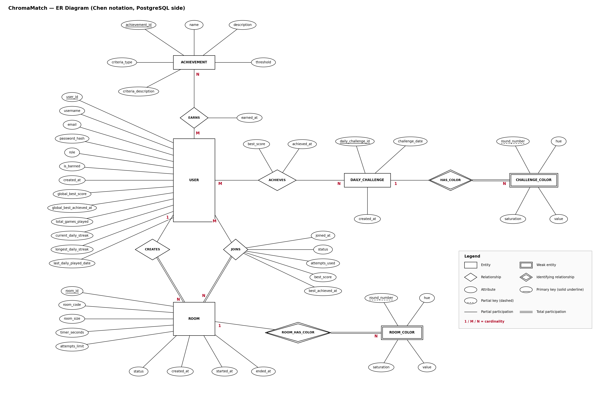
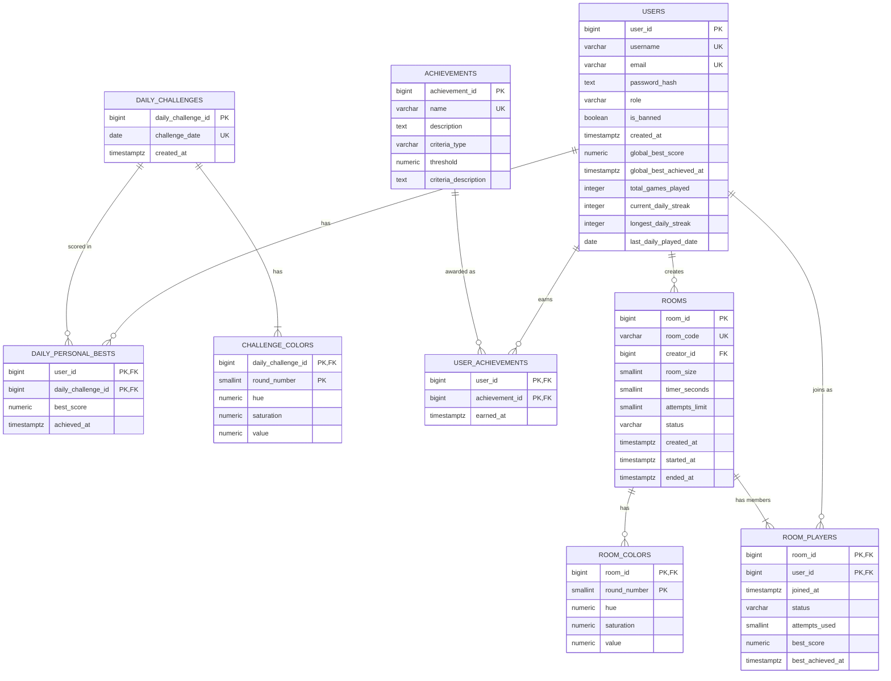

# ChromaMatch — Database Architecture & Design

> This document describes **everything about the data layer**: which databases are used and why, the ER diagram (Chen notation), the relational schema for PostgreSQL, the document model for MongoDB, integrity rules, indexes, and the planned advanced database features.
> The game itself is described in `ChromaMatch_Game_Design.md`.
>
> Status: **tentative**. The design can change in later phases. Items not yet decided are in [Section 11](#11-open-items-not-yet-decided).
> Scope: all three game modes — **Global, Daily and Custom Room** — are modeled.

---

## Table of contents

1. [Database architecture overview](#1-database-architecture-overview)
2. [Why these databases (justification)](#2-why-these-databases-justification)
3. [Conventions used across both databases](#3-conventions-used-across-both-databases)
4. [ER diagram (Chen notation)](#4-er-diagram-chen-notation)
5. [Relational schema (PostgreSQL)](#5-relational-schema-postgresql)
6. [Data dictionary (PostgreSQL)](#6-data-dictionary-postgresql)
7. [MongoDB data model](#7-mongodb-data-model)
8. [How the two databases work together](#8-how-the-two-databases-work-together)
9. [Planned advanced database features](#9-planned-advanced-database-features)
10. [Data validation, integrity and security](#10-data-validation-integrity-and-security)
11. [Open items (not yet decided)](#11-open-items-not-yet-decided)
12. [Decision log](#12-decision-log)

---

## 1. Database architecture overview

ChromaMatch uses **two database paradigms** (the project minimum):

| Database | Paradigm | Role | Source of truth for |
|---|---|---|---|
| **PostgreSQL** | SQL / relational | The system of record | Accounts, roles, bans, personal bests (global and daily), daily challenges and their colors, stat counters (games played, streaks), achievements and who earned them, **Custom Rooms, their shared colors, their members and each member's best room score** |
| **MongoDB** | NoSQL / document | The history log | The full round-by-round record of every completed game and room attempt |

A **vector database is not used.** The project brief lists it as optional, and nothing in ChromaMatch needs embeddings or similarity search.

```
        Next.js API route handlers (backend layer)
            │                              │
            ▼                              ▼
   ┌─────────────────┐            ┌──────────────────┐
   │   PostgreSQL    │            │     MongoDB      │
   │  (relational)   │            │   (documents)    │
   │                 │            │                  │
   │ users           │◄ ─ ─ ─ ─ ─ │ game_history     │
   │ daily_challenges│  logical   │  (one document   │
   │ challenge_colors│  links via │   per completed  │
   │ daily_personal_ │  user_id,  │   game / room    │
   │   bests         │  room_id,  │   attempt)       │
   │ achievements    │  daily_    │                  │
   │ user_achievements  challenge_│                  │
   │ rooms           │  id        │                  │
   │ room_colors     │            │                  │
   │ room_players    │            │                  │
   └─────────────────┘            └──────────────────┘
```

**What is deliberately *not* stored anywhere as its own table/collection:**

- **Leaderboards / ranks / room scoreboards.** A rank is a *derived* value (a sorted view of stored bests). Storing it would duplicate data and go stale every time a score changed. Rankings are computed at query time from `users.global_best_score` (global), `daily_personal_bests` (daily) and `room_players.best_score` (room).
- **Individual Global/Daily games and room attempts in Postgres.** Only the *current best* is kept in Postgres; every game lives in MongoDB.
- **RGB or hex colors.** HSV is the single source of truth; any other format is derived by the application when needed.

---

## 2. Why these databases (justification)

The project brief requires that the choice of SQL / NoSQL be justified by the nature of the data, not by technology demonstration.

### PostgreSQL — for the core, relational, must-be-correct data

- **The data is highly structured and interlinked.** Users own personal bests and earned achievements; daily challenges own colors; rooms own colors and members. These are classic entity relationships with primary keys, foreign keys and cardinalities.
- **Integrity matters.** Personal bests and room scores drive rankings. Constraints (`CHECK`, `UNIQUE`, `NOT NULL`, foreign keys) stop invalid scores, duplicate accounts, duplicate room codes and orphaned rows at the database level.
- **Several tables must change together.** Completing a game can update a personal best, several counters, a streak, and earned achievements. Starting a room sets its status *and* creates its colors. Each of these must be **atomic** — all of it or none of it — which is exactly what SQL **transactions** provide.
- **Rules that span rows need the database to enforce them.** "A room cannot exceed its size", "players can join only in the lobby", "one earned achievement per player" are best enforced where the data lives (constraints and triggers).
- **Rankings are naturally relational.** Sorting, ranking and joining are strengths of SQL (window functions, indexes, views).
- **Authentication data belongs here.** Accounts are the parent of everything else; self-managed auth with a hashed password lives naturally in a `users` table with unique constraints.

### MongoDB — for the game history log

- **Write-heavy, append-only.** One document is written per completed game or room attempt, forever growing; it is never updated afterward.
- **Naturally nested.** A game *contains* its three rounds, each with a target color, a guessed color and a score. That is one self-contained document, with no joins needed to read a game back.
- **Flexible shape.** Daily games carry a challenge reference; room attempts carry a room reference, an attempt number and timeout flags; Global games carry neither. One collection holds all three shapes without schema changes.
- **No relational integrity required.** Nothing depends on a history document through a foreign key. Leaderboards and room scoreboards never read from it.
- **Analytics via aggregation.** Averages, trends, and per-channel accuracy over many games are a natural fit for MongoDB's aggregation pipeline.

### Why not put everything in one database?

- History in Postgres would require ever-growing `games` and `rounds` tables that exist purely for analytics, with no integrity benefit.
- Accounts, bests and rooms in MongoDB would give up foreign keys, unique constraints across collections, and multi-table transactions — the features this data needs most.

---

## 3. Conventions used across both databases

| Topic | Convention |
|---|---|
| **Time** | All timestamps are stored in **UTC**. Postgres: `TIMESTAMPTZ`. MongoDB: BSON `Date`. |
| **Daily boundary** | A "day" is a **UTC calendar date**. The daily challenge resets at **00:00 UTC**. |
| **Color model** | **HSV** everywhere. Hue 0–360, Saturation 0–100, Value 0–100, each with **one decimal place**. |
| **Round score** | 0.0 to 10.0, one decimal place. |
| **Game / attempt score** | Sum of 3 round scores: 0.0 to 30.0, one decimal place. |
| **Identifiers** | Postgres primary keys are `BIGINT` identity columns. MongoDB stores the same numbers in its reference fields. |
| **Cross-database links** | `game_history.user_id`, `.daily_challenge_id` and `.room_id` point to Postgres rows. These are **logical, application-enforced links**, *not* database foreign keys (databases cannot enforce foreign keys across engines). |
| **Naming** | Tables and columns use `snake_case`; table names are plural. |

---

## 4. ER diagram (Chen notation)

The ER diagram covers the **SQL (PostgreSQL) side only**. Per the project brief, NoSQL components are documented as a data model (Section 7) rather than as an ER diagram, because ER constructs such as database-enforced foreign keys and fixed attribute sets do not apply to MongoDB collections.

### 4.0 The diagram



*File: `chromamatch_er_diagram.png` (a vector copy, `chromamatch_er_diagram.svg`, sits next to it). Keep the image files in the same folder as this document so the picture displays.*

This is the **official ER diagram**, drawn in **Chen notation** (rectangles for entities, ovals for attributes, diamonds for relationships, double outlines for weak entities and identifying relationships, double lines for total participation). It reflects everything in Sections 4.1–4.3 below, including the stat counters, the achievement rule columns and the whole Custom Room part.

> **Note:** The ER diagram image generated earlier in the project (`ChatGPT_Image_Aug_24__2026__08_01_38_PM.png`) is **outdated** and should not be used. It was made before the stat counters, the achievement rule columns and Custom Room were added, so it lacks four `USER` attributes, two `ACHIEVEMENT` attributes, and the entire room part (`ROOM`, `ROOM_COLOR`, `CREATES`, `ROOM_HAS_COLOR`, `JOINS`). The diagram above replaces it.

### 4.1 Entities

**1. USER** — strong entity (rectangle)

| Attribute | Notes |
|---|---|
| **user_id** | Primary key (underlined, solid) |
| username | |
| email | |
| password_hash | |
| role | `player` or `admin` |
| is_banned | |
| created_at | |
| global_best_score | The player's Global-mode personal best |
| global_best_achieved_at | When that PB was achieved |
| total_games_played | Completed Global + Daily games (room attempts excluded) |
| current_daily_streak | Consecutive UTC days with a completed Daily game, as of the last Daily game |
| longest_daily_streak | |
| last_daily_played_date | UTC date of the player's most recent completed Daily game |

**2. DAILY_CHALLENGE** — strong entity (rectangle)

| Attribute | Notes |
|---|---|
| **daily_challenge_id** | Primary key (underlined, solid) |
| challenge_date | The UTC date this challenge applies to |
| created_at | |

**3. CHALLENGE_COLOR** — **weak entity** (double-outlined rectangle), owned by DAILY_CHALLENGE

| Attribute | Notes |
|---|---|
| **round_number** | **Partial key** (underlined with a dashed line): 1, 2 or 3 |
| hue | |
| saturation | |
| value | |

**4. ACHIEVEMENT** — strong entity (rectangle)

| Attribute | Notes |
|---|---|
| **achievement_id** | Primary key (underlined, solid) |
| name | |
| description | Player-facing text |
| criteria_type | Machine-checkable rule kind (see Section 6.5) |
| threshold | Number the rule compares against (null for some types) |
| criteria_description | Human-readable explanation of the rule |

**5. ROOM** — strong entity (rectangle)

| Attribute | Notes |
|---|---|
| **room_id** | Primary key (underlined, solid) |
| room_code | Short unique code used to join |
| room_size | Maximum number of players (at least 2) |
| timer_seconds | Time to guess per round: 5, 10 or 15; empty (null) means no timer |
| attempts_limit | Attempts per player: 3 or 5 |
| status | `lobby`, `in_progress`, `finished` or `cancelled` |
| created_at | |
| started_at | Empty until the creator starts the room |
| ended_at | Empty until the room finishes or is cancelled |

**6. ROOM_COLOR** — **weak entity** (double-outlined rectangle), owned by ROOM

| Attribute | Notes |
|---|---|
| **round_number** | **Partial key** (underlined with a dashed line): 1, 2 or 3 |
| hue | |
| saturation | |
| value | |

### 4.2 Relationships

**1. HAS_COLOR** — **identifying relationship** (double-outlined diamond)
- Connects **DAILY_CHALLENGE** and **CHALLENGE_COLOR**.
- Cardinality: DAILY_CHALLENGE **1** : CHALLENGE_COLOR **N** (in practice exactly 3 colors per challenge).
- Participation: CHALLENGE_COLOR is **total** (double line) — a color cannot exist without its challenge. DAILY_CHALLENGE → HAS_COLOR is a single line.

**2. ACHIEVES** — regular relationship (diamond)
- Connects **USER** and **DAILY_CHALLENGE**.
- Cardinality: USER **M** : DAILY_CHALLENGE **N** (many-to-many). Both sides partial participation (single lines).
- Meaning: a user's **daily personal best** on a given day's challenge.
- Relationship attributes (ovals on the diamond): **best_score**, **achieved_at**.

**3. EARNS** — regular relationship (diamond)
- Connects **USER** and **ACHIEVEMENT**.
- Cardinality: USER **M** : ACHIEVEMENT **N** (many-to-many). Both sides partial participation.
- Meaning: which achievements a user has unlocked (each at most once).
- Relationship attribute: **earned_at**.

**4. CREATES** — regular relationship (diamond)
- Connects **USER** and **ROOM**.
- Cardinality: USER **1** : ROOM **N** (a user can create many rooms; each room has exactly one creator).
- Participation: ROOM is **total** (double line — every room has a creator); USER is partial (single line).

**5. ROOM_HAS_COLOR** — **identifying relationship** (double-outlined diamond)
- Connects **ROOM** and **ROOM_COLOR**.
- Cardinality: ROOM **1** : ROOM_COLOR **N** (exactly 3 colors once the room has started; none while it is in the lobby or if it was cancelled).
- Participation: ROOM_COLOR is **total** (double line). ROOM → ROOM_HAS_COLOR is a single line.

**6. JOINS** — regular relationship (diamond)
- Connects **USER** and **ROOM**.
- Cardinality: USER **M** : ROOM **N** (many-to-many: a user can be in many rooms; a room has many users). The creator is also a member.
- Participation: ROOM is **total** (double line — every room has at least its creator as a member); USER is partial (single line).
- Relationship attributes (ovals on the diamond): **joined_at**, **status** (`active`, `finished` or `left`), **attempts_used**, **best_score**, **best_achieved_at**.

### 4.3 Design notes on the ER model

- **Global PB is stored as attributes on USER**, not as a relationship, because it is strictly one value per user.
- **Daily PB is a relationship attribute pair on ACHIEVES**, because it is one value per (user, day).
- **A player's room score is stored on JOINS** (`best_score`), because it is one value per (user, room) — the same pattern as the daily PB.
- **CHALLENGE_COLOR and ROOM_COLOR are weak entities** because a color has no identity apart from "color N of challenge X / of room Y".
- **Roles are an attribute** (`role`) rather than a subtype hierarchy — only two roles exist and they share all attributes.
- **There is no LEADERBOARD or SCOREBOARD entity** — rankings are derived (Section 1).
- **Game history is not an entity here** — it lives in MongoDB (Section 7).
- **Room games do not touch USER's stat attributes** — they are intentionally separate from PBs, counters and achievements.

### 4.4 Layout instructions for drawing (Chen notation)

Place USER in the center. To its right, DAILY_CHALLENGE joined through ACHIEVES, and CHALLENGE_COLOR further right joined to DAILY_CHALLENGE through HAS_COLOR. Below (or above) USER, ACHIEVEMENT joined through EARNS. On the opposite side of USER (or below), ROOM joined to USER through **both** CREATES and JOINS (two separate diamonds between the same two entities), and ROOM_COLOR joined to ROOM through ROOM_HAS_COLOR.

Notation legend:

- Rectangle = entity; double rectangle = weak entity
- Oval = attribute, attached by a line to its entity or relationship
- Diamond = relationship; double diamond = identifying relationship
- Primary key = underlined with a solid line; partial key = underlined with a dashed line
- Single line = partial participation; double line = total participation
- Cardinalities written as 1, M, N next to the lines

### 4.5 Companion diagram (crow's-foot notation, mapped tables)

This is the same model drawn in crow's-foot notation *after* mapping to relational tables (each box is a table, with its columns listed). The Chen diagram in Section 4.0 is the official ER diagram.



---

## 5. Relational schema (PostgreSQL)

Produced by applying the standard ER-to-relational mapping rules. Primary keys are **bold**, foreign keys are marked with `→`.

| ER construct | Mapping rule | Resulting table |
|---|---|---|
| USER (strong entity) | One table; all attributes become columns | `users` |
| DAILY_CHALLENGE (strong entity) | One table | `daily_challenges` |
| CHALLENGE_COLOR (weak entity) + HAS_COLOR (identifying, 1:N) | Table includes the owner's PK as a foreign key; primary key = owner key + partial key | `challenge_colors` |
| ACHIEVES (M:N with attributes) | Separate table with both foreign keys as a composite PK, plus the relationship attributes | `daily_personal_bests` |
| ACHIEVEMENT (strong entity) | One table | `achievements` |
| EARNS (M:N with attribute) | Separate table with both foreign keys as a composite PK, plus the attribute | `user_achievements` |
| ROOM (strong entity) + CREATES (1:N) | One table; the creator's key becomes a foreign key on the N side (`creator_id`) | `rooms` |
| ROOM_COLOR (weak entity) + ROOM_HAS_COLOR (identifying, 1:N) | Table includes the room's PK as a foreign key; primary key = room key + partial key | `room_colors` |
| JOINS (M:N with attributes) | Separate table with both foreign keys as a composite PK, plus the relationship attributes | `room_players` |

### Relational schema

```
users (
  **user_id**, username, email, password_hash, role, is_banned, created_at,
  global_best_score, global_best_achieved_at,
  total_games_played, current_daily_streak, longest_daily_streak,
  last_daily_played_date
)

daily_challenges (
  **daily_challenge_id**, challenge_date, created_at
)

challenge_colors (
  **daily_challenge_id** → daily_challenges.daily_challenge_id,
  **round_number**,
  hue, saturation, value
)

daily_personal_bests (
  **user_id** → users.user_id,
  **daily_challenge_id** → daily_challenges.daily_challenge_id,
  best_score, achieved_at
)

achievements (
  **achievement_id**, name, description,
  criteria_type, threshold, criteria_description
)

user_achievements (
  **user_id** → users.user_id,
  **achievement_id** → achievements.achievement_id,
  earned_at
)

rooms (
  **room_id**, room_code, creator_id → users.user_id,
  room_size, timer_seconds, attempts_limit, status,
  created_at, started_at, ended_at
)

room_colors (
  **room_id** → rooms.room_id,
  **round_number**,
  hue, saturation, value
)

room_players (
  **room_id** → rooms.room_id,
  **user_id** → users.user_id,
  joined_at, status, attempts_used, best_score, best_achieved_at
)
```

### Foreign keys and delete behavior

| Foreign key | References | On delete | Reason |
|---|---|---|---|
| `challenge_colors.daily_challenge_id` | `daily_challenges` | CASCADE | Colors have no meaning without their challenge |
| `daily_personal_bests.user_id` | `users` | CASCADE | A PB belongs to the user |
| `daily_personal_bests.daily_challenge_id` | `daily_challenges` | RESTRICT | Past challenges are history and are never deleted while results exist |
| `user_achievements.user_id` | `users` | CASCADE | Earned achievements belong to the user |
| `user_achievements.achievement_id` | `achievements` | RESTRICT | An achievement definition cannot be removed while anyone has earned it |
| `rooms.creator_id` | `users` | RESTRICT | Deleting a user must not silently delete a room other people played in |
| `room_colors.room_id` | `rooms` | CASCADE | Colors have no meaning without their room |
| `room_players.room_id` | `rooms` | CASCADE | Membership belongs to the room |
| `room_players.user_id` | `users` | CASCADE | Membership belongs to the user |

Note: users are normally **banned, not deleted**. A hard delete would also require handling that user's rooms (blocked by `RESTRICT` on `rooms.creator_id`) and removing that user's documents from MongoDB, since that link is not database-enforced.

---

## 6. Data dictionary (PostgreSQL)

Types and sizes are the proposed starting point for the DDL and may be refined.

### 6.1 `users`

| Column | Type | Null? | Default | Constraints | Description |
|---|---|---|---|---|---|
| `user_id` | BIGINT | NO | identity (auto) | **PK** | Unique account id |
| `username` | VARCHAR(30) | NO | — | UNIQUE | Display name shown on leaderboards |
| `email` | VARCHAR(255) | NO | — | UNIQUE (stored lowercase) | Login identifier |
| `password_hash` | TEXT | NO | — | — | Secure hash (bcrypt/argon2) — never the plain password |
| `role` | VARCHAR(10) | NO | `'player'` | CHECK in (`'player'`, `'admin'`) | Access level |
| `is_banned` | BOOLEAN | NO | `FALSE` | — | If true, hidden from Global and Daily leaderboards |
| `created_at` | TIMESTAMPTZ | NO | now() | — | Registration time (UTC) |
| `global_best_score` | NUMERIC(3,1) | YES | NULL | CHECK 0 ≤ value ≤ 30 | Best Global game score; NULL until the first Global game |
| `global_best_achieved_at` | TIMESTAMPTZ | YES | NULL | NULL exactly when `global_best_score` is NULL | When that PB was set |
| `total_games_played` | INTEGER | NO | 0 | CHECK ≥ 0 | Completed Global + Daily games (room attempts not counted) |
| `current_daily_streak` | INTEGER | NO | 0 | CHECK ≥ 0 | Streak as of `last_daily_played_date` |
| `longest_daily_streak` | INTEGER | NO | 0 | CHECK ≥ `current_daily_streak` | Best streak ever |
| `last_daily_played_date` | DATE | YES | NULL | — | UTC date of last completed Daily game |

**Streak rule (applied when a Daily game completes on UTC date D):**

- If `last_daily_played_date` = D → the streak is unchanged (already counted today).
- If `last_daily_played_date` = D − 1 day → `current_daily_streak` increases by 1.
- Otherwise (never played, or a day was skipped) → `current_daily_streak` becomes 1.
- Then `longest_daily_streak` is raised if the current streak exceeds it, and `last_daily_played_date` is set to D.

**Display nuance:** `current_daily_streak` is only updated when a Daily game is played. When *showing* a streak, treat it as 0 if `last_daily_played_date` is earlier than yesterday (UTC).

### 6.2 `daily_challenges`

| Column | Type | Null? | Default | Constraints | Description |
|---|---|---|---|---|---|
| `daily_challenge_id` | BIGINT | NO | identity | **PK** | Challenge id |
| `challenge_date` | DATE | NO | — | UNIQUE | UTC date; exactly one challenge per date |
| `created_at` | TIMESTAMPTZ | NO | now() | — | When the row was created |

The 3 colors for a date come from a random generator **seeded by the date**, so the same date always yields the same colors. The row and its 3 colors are created together (one transaction) the first time they are needed for that date, or by a scheduled job.

### 6.3 `challenge_colors`

| Column | Type | Null? | Constraints | Description |
|---|---|---|---|---|
| `daily_challenge_id` | BIGINT | NO | **PK (part)**, FK → `daily_challenges` ON DELETE CASCADE | Owning challenge |
| `round_number` | SMALLINT | NO | **PK (part)**, CHECK 1 ≤ value ≤ 3 | Which of the day's 3 colors (the identity of the color, **not** the order a given player sees it in) |
| `hue` | NUMERIC(4,1) | NO | CHECK 0 ≤ value ≤ 360 | Target hue |
| `saturation` | NUMERIC(4,1) | NO | CHECK 0 ≤ value ≤ 100 | Target saturation |
| `value` | NUMERIC(4,1) | NO | CHECK 0 ≤ value ≤ 100 | Target value (brightness). `value` is permitted as a column name in PostgreSQL |

The composite primary key plus the 1–3 check guarantee **at most 3** colors per challenge. "Exactly 3" is guaranteed by creating the challenge and its 3 colors in a single transaction.

### 6.4 `daily_personal_bests`

| Column | Type | Null? | Constraints | Description |
|---|---|---|---|---|
| `user_id` | BIGINT | NO | **PK (part)**, FK → `users` ON DELETE CASCADE | The player |
| `daily_challenge_id` | BIGINT | NO | **PK (part)**, FK → `daily_challenges` ON DELETE RESTRICT | The day's challenge |
| `best_score` | NUMERIC(3,1) | NO | CHECK 0 ≤ value ≤ 30 | Best game score that player achieved that day |
| `achieved_at` | TIMESTAMPTZ | NO | — | When that best score was set |

A row is created when a player completes their first Daily game of a day; afterwards it is updated **only** when a later game that day scores **strictly higher**. Rows are kept after the day ends.

### 6.5 `achievements`

| Column | Type | Null? | Constraints | Description |
|---|---|---|---|---|
| `achievement_id` | BIGINT | NO | **PK**, identity | Achievement id |
| `name` | VARCHAR(60) | NO | UNIQUE | Display name |
| `description` | TEXT | NO | — | Player-facing description |
| `criteria_type` | VARCHAR(20) | NO | CHECK in the list below | The kind of rule the system evaluates |
| `threshold` | NUMERIC(6,1) | YES | CHECK > 0 when present | The number the rule compares against |
| `criteria_description` | TEXT | NO | — | Plain-language statement of the rule |

**Criteria types** (evaluated automatically after each completed **Global or Daily** game; room attempts never trigger achievements):

| `criteria_type` | Earned when | `threshold` meaning |
|---|---|---|
| `games_played` | `total_games_played` ≥ threshold | Number of games (required) |
| `daily_streak` | `current_daily_streak` ≥ threshold | Streak length in days (required) |
| `perfect_round` | Any round of the game just completed scored ≥ threshold | Minimum round score (required) |
| `new_pb` | The game just completed beat an *existing* PB (global or daily) | Not used (NULL) |
| `first_daily` | The player completes their first Daily game | Not used (NULL) |
| `first_global` | The player completes their first Global game | Not used (NULL) |

A constraint ensures `threshold` is present for `games_played`, `daily_streak` and `perfect_round`, and absent for the other three.

The achievement rows themselves are inserted by a **seed script** prepared by the developers (admins do not create achievements). The exact list and thresholds are still to be finalized.

### 6.6 `user_achievements`

| Column | Type | Null? | Default | Constraints | Description |
|---|---|---|---|---|---|
| `user_id` | BIGINT | NO | — | **PK (part)**, FK → `users` ON DELETE CASCADE | The player |
| `achievement_id` | BIGINT | NO | — | **PK (part)**, FK → `achievements` ON DELETE RESTRICT | The achievement |
| `earned_at` | TIMESTAMPTZ | NO | now() | — | When it was unlocked |

The composite primary key ensures an achievement can be earned **only once** per player.

### 6.7 `rooms`

| Column | Type | Null? | Default | Constraints | Description |
|---|---|---|---|---|---|
| `room_id` | BIGINT | NO | identity | **PK** | Room id |
| `room_code` | VARCHAR(8) | NO | — | UNIQUE | Short random alphanumeric code used to join; never reused |
| `creator_id` | BIGINT | NO | — | FK → `users` ON DELETE RESTRICT | The player who created the room |
| `room_size` | SMALLINT | NO | — | CHECK ≥ 2 | Maximum number of players (an upper limit is still to be decided) |
| `timer_seconds` | SMALLINT | YES | NULL | CHECK in (5, 10, 15) when present | Time to guess per round; NULL means no timer |
| `attempts_limit` | SMALLINT | NO | — | CHECK in (3, 5) | Attempts each player gets (no infinite option) |
| `status` | VARCHAR(12) | NO | `'lobby'` | CHECK in (`'lobby'`, `'in_progress'`, `'finished'`, `'cancelled'`) | Lifecycle state |
| `created_at` | TIMESTAMPTZ | NO | now() | — | When the room was created |
| `started_at` | TIMESTAMPTZ | YES | NULL | Set only when status is `in_progress` or `finished` | When the creator started it |
| `ended_at` | TIMESTAMPTZ | YES | NULL | Set only when status is `finished` or `cancelled` | When it ended or was cancelled |

**Room lifecycle**

```
lobby ──(creator starts, ≥ 2 players)──► in_progress ──(every player done)──► finished
  │
  └──(creator leaves the lobby)──► cancelled
```

- `lobby`: players join with the room code. No colors exist yet.
- `in_progress`: joining is closed; the 3 shared colors exist; players play their attempts.
- `finished`: every member is done (all attempts used, or left). Kept for history.
- `cancelled`: the creator left before starting. Kept for history (open item).

### 6.8 `room_colors`

| Column | Type | Null? | Constraints | Description |
|---|---|---|---|---|
| `room_id` | BIGINT | NO | **PK (part)**, FK → `rooms` ON DELETE CASCADE | Owning room |
| `round_number` | SMALLINT | NO | **PK (part)**, CHECK 1 ≤ value ≤ 3 | Which of the room's 3 colors (the identity of the color, **not** the order a given player sees it in) |
| `hue` | NUMERIC(4,1) | NO | CHECK 0 ≤ value ≤ 360 | Target hue |
| `saturation` | NUMERIC(4,1) | NO | CHECK 0 ≤ value ≤ 100 | Target saturation |
| `value` | NUMERIC(4,1) | NO | CHECK 0 ≤ value ≤ 100 | Target value (brightness) |

The 3 colors are **randomly generated at the moment the creator starts the room**, in the same transaction that changes the room's status to `in_progress`. They never change afterwards, and every player in the room plays these same 3 colors.

### 6.9 `room_players`

| Column | Type | Null? | Default | Constraints | Description |
|---|---|---|---|---|---|
| `room_id` | BIGINT | NO | — | **PK (part)**, FK → `rooms` ON DELETE CASCADE | The room |
| `user_id` | BIGINT | NO | — | **PK (part)**, FK → `users` ON DELETE CASCADE | The member (the creator is a member too) |
| `joined_at` | TIMESTAMPTZ | NO | now() | — | When they joined |
| `status` | VARCHAR(10) | NO | `'active'` | CHECK in (`'active'`, `'finished'`, `'left'`) | `active`: still has attempts to play. `finished`: used all attempts. `left`: left after the room started (forfeited the rest) |
| `attempts_used` | SMALLINT | NO | 0 | CHECK ≥ 0 | Completed attempts. Must never exceed the room's `attempts_limit` (cross-table rule, enforced by the procedure/trigger) |
| `best_score` | NUMERIC(3,1) | YES | NULL | CHECK 0 ≤ value ≤ 30 | Best completed attempt; NULL until the first completed attempt |
| `best_achieved_at` | TIMESTAMPTZ | YES | NULL | NULL exactly when `best_score` is NULL | When that best was set |

Rules enforced by procedures/triggers because they span tables or rows:

- A row can only be inserted while the room's status is `lobby`.
- The number of members cannot exceed the room's `room_size`.
- A member with status `finished` or `left` cannot submit more attempts.
- A member leaving the **lobby** has their row deleted (they never committed to the game). A member leaving **after the start** keeps their row with status `left` so their best score still counts.
- `best_score` only changes when a completed attempt scores **strictly higher**.

The room scoreboard is simply the members of a room ordered by `best_score` descending, members with NULL `best_score` last.

---

## 7. MongoDB data model

### 7.1 Collection overview

| Item | Value |
|---|---|
| Database | `chromamatch` |
| Collection | `game_history` |
| One document = | One **completed** game (Global/Daily) or **completed** room attempt. Incomplete games are never written. |
| Write pattern | Insert once, never updated |
| Used for | Statistics, trend analysis, admin review of a player's history, future features |
| **Not** used for | Leaderboards, personal bests, room scoreboards, rankings, achievements logic — all of these are authoritative in PostgreSQL |

All three modes share one collection; the `mode` field tells them apart. Because room attempts are **separate from a player's overall stats**, any aggregation that feeds a player's Global/Daily statistics must filter on `mode` (exclude `"room"`).

### 7.2 Document structure

A **Daily** game:

```json
{
  "_id": "ObjectId",
  "user_id": 42,
  "mode": "daily",
  "daily_challenge_id": 118,
  "played_at": "2026-10-17T14:32:08Z",
  "total_score": 24.6,
  "rounds": [
    {
      "round_number": 1,
      "color_number": 3,
      "target": { "h": 214.6, "s": 62.0, "v": 80.5 },
      "guess":  { "h": 209.0, "s": 58.5, "v": 77.0 },
      "score": 8.9
    },
    { "round_number": 2, "color_number": 1, "target": {}, "guess": {}, "score": 7.4 },
    { "round_number": 3, "color_number": 2, "target": {}, "guess": {}, "score": 8.3 }
  ]
}
```

A **Global** game has the same shape but **no** `daily_challenge_id` and **no** `color_number` in its rounds (its colors are random, not part of a fixed set).

A **Room** attempt:

```json
{
  "_id": "ObjectId",
  "user_id": 42,
  "mode": "room",
  "room_id": 7,
  "attempt_number": 2,
  "played_at": "2026-10-17T15:10:44Z",
  "total_score": 22.1,
  "rounds": [
    {
      "round_number": 1,
      "color_number": 2,
      "target": { "h": 12.0, "s": 90.0, "v": 70.0 },
      "guess":  { "h": 18.5, "s": 84.0, "v": 66.0 },
      "score": 7.6,
      "timed_out": false
    },
    { "round_number": 2, "color_number": 3, "target": {}, "guess": {}, "score": 6.9, "timed_out": true },
    { "round_number": 3, "color_number": 1, "target": {}, "guess": {}, "score": 7.6, "timed_out": false }
  ]
}
```

(In every example, rounds 2 and 3 are abbreviated; every round contains full `target` and `guess` objects.)

### 7.3 Field reference

| Field | Type | Present | Description |
|---|---|---|---|
| `_id` | ObjectId | always | Generated by MongoDB |
| `user_id` | Int64 | always | Logical reference to `users.user_id` in PostgreSQL (not a database foreign key) |
| `mode` | String | always | `"global"`, `"daily"` or `"room"` |
| `daily_challenge_id` | Int64 | Daily games only | Logical reference to `daily_challenges.daily_challenge_id` |
| `room_id` | Int64 | Room attempts only | Logical reference to `rooms.room_id` |
| `attempt_number` | Int | Room attempts only | 1 to the room's attempt limit (3 or 5): which of the player's attempts this was |
| `played_at` | Date (UTC) | always | When the game/attempt was completed |
| `total_score` | Double | always | Sum of the 3 round scores, 0–30, one decimal place |
| `rounds` | Array (exactly 3) | always | The three rounds, in the order **played** |
| `rounds[].round_number` | Int | always | 1, 2 or 3 — the order in which this player played the round |
| `rounds[].color_number` | Int | Daily and Room | 1–3 — which of the shared colors this was (`challenge_colors.round_number` for Daily, `room_colors.round_number` for Room). Because each player sees the shared colors in a shuffled order, this field records the player's actual order |
| `rounds[].target` | Object `{h, s, v}` | always | The target HSV color (for Global the random color that was generated; for Daily/Room the shared color) |
| `rounds[].guess` | Object `{h, s, v}` | always | The player's submitted HSV color |
| `rounds[].score` | Double | always | Round score, 0–10, one decimal place |
| `rounds[].timed_out` | Boolean | Room attempts only | `true` if the time limit expired and the slider position was auto-submitted; always `false` in rooms with no timer |

### 7.4 Indexes

| Index | Purpose |
|---|---|
| `{ user_id: 1, played_at: -1 }` | A player's history, newest first (profile page, admin review); the most common query |
| `{ mode: 1, played_at: -1 }` | Recent games per mode; time-window analytics |
| `{ daily_challenge_id: 1, user_id: 1 }` (sparse — only Daily documents) | All games for a given day's challenge; one player's games on one day |
| `{ room_id: 1, user_id: 1, attempt_number: 1 }` (sparse — only Room documents) | All attempts in a room; one player's attempts in a room |

### 7.5 Retrieval strategy and aggregations

Typical operations and how MongoDB serves them:

| Need | Approach |
|---|---|
| A player's recent games | Query on `user_id`, sorted by `played_at` descending, paginated (uses index 1) |
| Average / best / worst game score per mode for a player | Aggregation: match on `user_id`, group by `mode`, compute avg/max/min of `total_score` |
| Score trend over time | Aggregation: match on `user_id` (and `mode` global/daily), group by day or week of `played_at`, average `total_score` |
| Average accuracy per color channel | Aggregation: unwind `rounds`, compute the absolute difference between `guess` and `target` for H, S and V (hue measured the short way around the circle), then average per player |
| Accuracy by hue region (which colors a player struggles with) | Aggregation: unwind `rounds`, bucket by `target.h` into ranges, average `score` per bucket |
| How a given day's challenge went overall | Aggregation: match on `daily_challenge_id`, group by `color_number`, average `rounds.score` |
| How a room went (e.g. which color was hardest, how often players timed out) | Aggregation: match on `room_id`, unwind `rounds`, group by `color_number`, average `score` and count `timed_out` |
| A player's attempt-by-attempt progress inside a room | Query on `room_id` + `user_id`, sorted by `attempt_number` (uses index 4) |
| Admin viewing a player's history | Same as "a player's recent games" |

### 7.6 Integrity in MongoDB

MongoDB does not enforce a schema by default, so a **JSON Schema validator** is applied to the collection to enforce, at the database level:

- Required fields: `user_id`, `mode`, `played_at`, `total_score`, `rounds`
- `mode` must be `"global"`, `"daily"` or `"room"`
- `rounds` must contain **exactly 3** items
- `h` between 0 and 360; `s` and `v` between 0 and 100
- Round `score` between 0 and 10; `total_score` between 0 and 30
- `daily_challenge_id` and `rounds[].color_number` required when `mode` is `"daily"`
- `room_id`, `attempt_number` and `rounds[].color_number` required when `mode` is `"room"`

---

## 8. How the two databases work together

### 8.1 What happens when a Global or Daily game is completed

1. **Browser → API.** The browser sends the **whole completed game** (the 3 guesses) in one request. The browser never sees or submits the true scores — the server computes them.
2. **Server scoring.** The API scores each round (weighted Euclidean distance over H, S, V → 0–10) against the target colors it holds, and sums them.
3. **PostgreSQL transaction (one stored procedure call).** In a single atomic transaction it:
   - locks the player's row;
   - increments `total_games_played`;
   - **Global game:** if `total_score` is strictly greater than `global_best_score` (or the PB is NULL), updates `global_best_score` and `global_best_achieved_at`;
   - **Daily game:** inserts or updates the player's `daily_personal_bests` row for that day (updating only if strictly greater), and applies the **streak rule** (Section 6.1);
   - evaluates every achievement the player has not yet earned and inserts newly earned ones into `user_achievements`;
   - returns a summary (new PB?, achievements unlocked).
4. **MongoDB insert.** The API writes the game document to `game_history`.
5. **Response.** The player sees the result, any new PB, and any unlocked achievements.

Postgres is written **first** so that the authoritative data is always correct.

### 8.2 What happens in a Custom Room

All room operations run as transactions in PostgreSQL. None of them touch `users` stats, PBs, streaks or achievements.

| Operation | What the transaction does |
|---|---|
| **Create room** | Generates a unique `room_code`; inserts the `rooms` row (status `lobby`) and inserts the creator into `room_players` (status `active`) |
| **Join room** | Looks up the room by code; verifies status is `lobby` and the room is not full; inserts the player into `room_players`. A trigger enforces "lobby only" and "not above `room_size`" as a safety net |
| **Leave (lobby)** | Deletes the member's `room_players` row. If the leaver is the creator, sets the room to `cancelled` and records `ended_at` |
| **Start room** | Only the creator, only in `lobby`, only with at least 2 members: inserts the 3 random `room_colors`, sets status `in_progress`, records `started_at` |
| **Submit room attempt** | Verifies the room is `in_progress`, the member is `active` and `attempts_used` < `attempts_limit`; increments `attempts_used`; if `total_score` is strictly greater than `best_score` (or it is NULL) updates `best_score` and `best_achieved_at`; if `attempts_used` now equals the limit, sets the member's status to `finished`; then checks whether the room is over |
| **Leave (in progress)** | Sets the member's status to `left` (their `best_score` stays); then checks whether the room is over |
| **Room-over check** | If no member is still `active`, sets the room to `finished` and records `ended_at` |

For a **room attempt**, the browser sends the whole completed attempt (3 guesses, in the order the player played them, plus a flag per round saying whether the timer expired). The server scores it exactly as in Section 8.1, runs the Postgres transaction above, then inserts the attempt document (mode `"room"`) into MongoDB.

### 8.3 Known limitation

A transaction **cannot span PostgreSQL and MongoDB.** If the MongoDB write fails after the Postgres transaction commits, the game counts toward PBs, counters, achievements or room scores but is missing from the history log. This is acceptable because history is supplementary; the authoritative data stays consistent. The limitation should be stated in the project documentation.

Related: admin edits to player stats change Postgres only. They do not rewrite `game_history`, so history and stats can legitimately differ after an admin correction.

### 8.4 Ranking queries (derived from Postgres)

| Ranking | Derived from | Filter / order |
|---|---|---|
| **Global leaderboard** | `users` | Exclude banned users and users with no PB; order by `global_best_score` descending; ties arbitrary |
| **Daily leaderboard (for a date)** | `daily_personal_bests` joined to `users` | Filter on that day's `daily_challenge_id`; exclude banned users; order by `best_score` descending; ties arbitrary |
| **Room scoreboard** | `room_players` joined to `users` | Filter on the room; order by `best_score` descending, members with no score last; ties arbitrary |
| **A player's own rank** | Same data | Count of players with a higher score, plus one (computed with a ranking window function) |

---

## 9. Planned advanced database features

The brief requires at least four advanced concepts. This design plans for six; the exact implementation may be refined.

| Feature | Where it is used |
|---|---|
| **Transactions** | Completing a Global/Daily game updates PB, counters, streak and earned achievements atomically. Creating a daily challenge and its 3 colors is one transaction. Starting a room (status change + 3 colors) is one transaction. Submitting a room attempt and leaving a room are transactions |
| **Stored procedures / functions** | A `submit game result` procedure performs the whole Postgres side of a completed Global/Daily game (Section 8.1). Further procedures for the room operations in Section 8.2 (create, join, start, submit attempt, leave). Helper functions may compute the streak and evaluate achievement criteria |
| **Triggers** | Enforce room rules that `CHECK` constraints cannot express: joining only while the room is in `lobby`, and never exceeding `room_size`; keeping `attempts_used` within `attempts_limit`. Candidate: awarding achievements when a player's stats change (final choice between "inside the procedure" and "separate trigger" is made at implementation) |
| **Views** | `global_leaderboard`, `daily_leaderboard` and `room_scoreboard` views that exclude banned users where applicable and attach ranks, so the application simply queries a view |
| **Indexing** | Postgres: partial index on `users(global_best_score DESC)` for non-banned players with a PB; index on `daily_personal_bests(daily_challenge_id, best_score DESC)`; index on `room_players(room_id, best_score DESC)`; index on `room_players(user_id)` ("my rooms"); index on `rooms(status)`. MongoDB: indexes in Section 7.4 |
| **NoSQL aggregation** | The MongoDB aggregation pipelines in Section 7.5 |

The DDL deliverable should also demonstrate `ALTER` and `DROP` on suitable objects, as listed in the project requirements.

---

## 10. Data validation, integrity and security

### 10.1 Validation at the database level (project requirement)

**PostgreSQL**

- `NOT NULL` on every mandatory column
- `UNIQUE`: `users.username`, `users.email`, `daily_challenges.challenge_date`, `achievements.name`, `rooms.room_code`
- `CHECK`: HSV ranges; `round_number` 1–3; scores 0–30; counters ≥ 0; `longest_daily_streak ≥ current_daily_streak`; `role` in (`player`, `admin`); `criteria_type` in the allowed list; `threshold` presence rules per `criteria_type`; `global_best_score` / `global_best_achieved_at` null together; `best_score` / `best_achieved_at` null together; `room_size ≥ 2`; `timer_seconds` in (5, 10, 15) or NULL; `attempts_limit` in (3, 5); room `status` and member `status` in their allowed lists; `started_at` / `ended_at` consistent with room status
- Primary keys and foreign keys with explicit delete behavior (Section 5)
- Composite primary keys that make duplicates impossible (one daily PB per user per day; one earned achievement per user; one membership per user per room)
- Triggers/procedures for cross-row and cross-table rules (room capacity, lobby-only joining, attempts within limit)

**MongoDB**

- JSON Schema validator (Section 7.6)

### 10.2 How consistency is maintained

- Multi-table changes happen inside transactions.
- Derived data (ranks, RGB/hex) is **not stored**, so it cannot go out of sync.
- PBs and room best scores only change through the dedicated submission procedures (plus deliberate admin edits).
- Scores are computed **server-side**; the client cannot submit its own scores.
- The room's shared colors are created once, at start, in the same transaction as the status change, so a started room always has exactly 3 colors.

### 10.3 Security

- Passwords are stored only as a salted hash (bcrypt or argon2); never in plain text.
- Database credentials and secrets are supplied through environment variables and never committed to source control.
- All database access goes through the Next.js API layer; the browser never connects to a database.
- Role checks (player vs. admin) are enforced in the API before any admin action. Room actions check membership (only members see a room's scoreboard; only the creator can start a room).
- Queries use parameters (no string-built SQL).
- Room codes are random, so rooms cannot be found by guessing sequential ids.

---

## 11. Open items (not yet decided)

| # | Item | Notes |
|---|---|---|
| 1 | **Audit log for admin stat edits** (a table recording admin, target user, field, old/new value, time) | Optional; proposed but not decided. Not in the schema above |
| 2 | Maximum **room size** | Minimum is 2; the `CHECK` has no upper bound yet |
| 3 | What happens to a room if the **creator leaves the lobby** | Current assumption: room is `cancelled` |
| 4 | Whether **cancelled** rooms and abandoned lobbies are kept or cleaned up | Cancelled rooms are kept for now; stale-lobby cleanup undecided |
| 5 | Retention of **finished rooms** | Currently: keep forever |
| 6 | Whether players see **live standings** during a room or only at the end | Does not change the schema |
| 7 | Whether **banned** players appear in room scoreboards | Currently the room view does not filter them |
| 8 | How strictly the server verifies **room timers** | Timer runs in the browser; the `timed_out` flag is reported by the client |
| 9 | Whether the **shuffled order** (Daily/Room) is fixed per player or re-shuffled each game/attempt | The order actually played is recorded in `color_number` either way |
| 10 | Whether room attempt documents stay in the same collection (`game_history`) or get their own | Currently the same collection, `mode: "room"` |
| 11 | Whether a **banned** player can still log in and play | Affects API logic, not the schema |
| 12 | Which **day** a Daily game belongs to if it spans midnight UTC | Suggested: the day it started. Affects the submission procedure |
| 13 | **Precision of scores** | Assumed one decimal place (`NUMERIC(3,1)`) |
| 14 | **Primary key type** for `users`, etc. | `BIGINT` identity assumed; `UUID` is an alternative |
| 15 | Exact **achievement list** and thresholds | Only the rule types are fixed |
| 16 | Which stats an **admin may edit** | Presumably the PB columns and counters |
| 17 | Whether achievement awarding lives **inside the procedure or in a separate trigger** | Decide at implementation |
| 18 | **Hue upper bound**: whether generated target hues can be exactly 360 | Constraint currently allows 0–360 inclusive |
| 19 | Exact **column sizes** (username length, room code length, etc.) | Proposed values in Section 6 |
| 20 | Retention of MongoDB history (keep forever vs. archive) | Currently: keep forever |

---

## 12. Decision log

| Area | Decision |
|---|---|
| Databases | PostgreSQL (SQL) + MongoDB (NoSQL); no vector database |
| ER diagram | Chen notation, SQL side only; all three modes included |
| ER entities | USER, DAILY_CHALLENGE, CHALLENGE_COLOR (weak), ACHIEVEMENT, ROOM, ROOM_COLOR (weak) |
| ER relationships | HAS_COLOR (identifying, 1:N), ACHIEVES (M:N), EARNS (M:N), CREATES (1:N), ROOM_HAS_COLOR (identifying, 1:N), JOINS (M:N with `joined_at`, `status`, `attempts_used`, `best_score`, `best_achieved_at`) |
| Global PB | Stored as two attributes on USER |
| Daily PB | Stored in the ACHIEVES relationship (`daily_personal_bests`) |
| Room score | Stored in the JOINS relationship (`room_players.best_score`) |
| Leaderboards / scoreboards | Not stored; derived by query/view |
| Roles | `role` attribute: `player` / `admin` |
| Bans | `is_banned` flag; hidden from Global/Daily leaderboards; data kept |
| Auth | Self-managed email + password hash in `users` |
| Colors | HSV as separate numeric columns; no RGB/hex stored |
| Daily colors | 3 per day, generated from a date seed, stored in `challenge_colors`; per-player order shuffled and recorded only in MongoDB history |
| Room colors | 3 random colors generated when the creator starts the room, stored in `room_colors`; per-player order shuffled and recorded only in MongoDB history |
| Room settings | `room_size` ≥ 2; `timer_seconds` in (5, 10, 15) or NULL; `attempts_limit` in (3, 5); no infinite attempts |
| Room lifecycle | `lobby` → `in_progress` → `finished`; or `lobby` → `cancelled` |
| Room start | Manual by the creator, needs at least 2 members |
| Room end | Automatic when no member is `active` (all attempts used or left) |
| Room leaving | Lobby: row deleted. After start: status `left`, best score kept, remaining attempts forfeited |
| Room vs. stats | Room attempts never change `users` stats, PBs, streaks, games-played or achievements |
| Timer expiry | Current slider position auto-submitted and scored normally; recorded as `timed_out` in MongoDB |
| Stat counters in Postgres | `total_games_played`, `current_daily_streak`, `longest_daily_streak`, `last_daily_played_date` — needed because Postgres cannot read MongoDB when awarding achievements |
| Achievements | Rules stored as `criteria_type` + `threshold`; awarded automatically for Global/Daily games; seeded by developers |
| MongoDB | One collection, `game_history`, one document per completed game/attempt, insert-only; `mode` is `global`, `daily` or `room` |
| Incomplete games | Never persisted in either database |
| Cross-database links | `user_id`, `daily_challenge_id`, `room_id` in MongoDB reference Postgres rows; enforced by the application |
| Write order | PostgreSQL transaction first, then MongoDB insert |
| Time zone | UTC everywhere; daily reset at 00:00 UTC |
